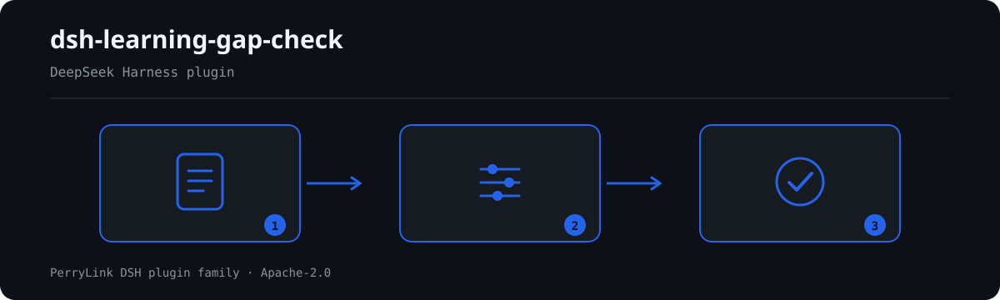

# dsh-learning-gap-check — 能力差距与培养计划核对

[English](README.md) · [简体中文](README-zh.md) · [Español](README-es.md) · [Português](README-pt.md) · [हिन्दी](README-hi.md)

[](https://dsh.market/)
[](https://dshfind.com/en/plugins/PerryLink/dsh-learning-gap-check?ref=badge)

`dsh-learning-gap-check` 读取一份能力差距与培养计划台账——员工表头加每项能力一行——核对这份台账自身的算术与闭环：每条差距是否写明岗位与能力项、记录的两个等级是否可解析为数值、差距是否等于要求等级减现有等级、超过你配置阈值的差距是否填写培养措施、培养措施是否写明责任人与完成期限、完成日期是否不晚于完成期限、培养状态是否出自本机构口径的取值。

## Install

```sh
dsh plugin --profile <name> add dsh-learning-gap-check
dsh --profile <name> --dump-config | grep 'dsh-learning-gap-check'
```

## 实际输出长什么样



*工作流概览：文档 → 规则包 → 核对结果。下面的示例使用实际命令面。*


本插件对自己 `LG-002` 测试夹具的**真实输出**，不是示意图。规则库不伪造引文，因此每条发现都会同时写明所引条款，以及该条款原文本次未取得。

## 它回答什么问题

### 示例

下表是示例集：第一行是详细走查，其余行是简短案例。


#### 详细输出

**工具** `learning_gap_check`

**输入**

~~~json
{"employee":"张工","department":"设备部","rows":[{"岗位":"","能力项":"","要求等级":"4","现有等级":"2","差距等级":"2"}]}
~~~
 
**输出**

~~~json
{
  "id": "dsh-learning-gap-check.LG-001.de09b5a6",
  "ruleId": "LG-001",
  "severity": "warn",
  "locator": {
    "row": 1,
    "field": "position"
  },
  "found": "第 1 行 position、competency 都为空",
  "expected": "position、competency 至少应填写一项"
}
~~~

*来源 `dsh-learning-gap-check/tests/fixtures/LG-001/LG-001-unsafe.json`*

| 你会问 | 它怎么答 |
|---|---|
| 某行填了能力项，岗位栏空着，会被报出吗？ | `LG-001` 只在 `position` 与 `competency` 都为空时报出该行，填写其中任意一项即通过。它只核对这一行有没有写明岗位与能力项，不判断该岗位的能力要求是否合理、是否完整。 |
| 台账里的等级写成「熟练」「掌握」，或者写成 A、B、C，会怎么处理？ | `LG-002` 读 `actualLevel`，要求它可解析为数值，写成文字或字母会按不可解析报出。本插件不内置任何能力等级刻度：请把台账改成可比较的数字刻度，或连同 `LG-003` 一起停用。它只核对可解析性，不判断评估结果是否客观、是否准确。 |
| 差距栏写 `3`，但要求等级 `4` 减现有等级 `2` 得 `2`，这能查出来吗？ | 能。`LG-003` 按 `requiredLevel − actualLevel` 重算，容差为 `0`，与台账里存的 `gapLevel` 不符即报出该行。只有三个字段都是可解析数值时本条才执行，缺任一项即进 `skipped`。负值如实报出——可能是两栏填反了；差距大到什么程度才算问题，本条不作判断。 |
| 某行填了培养措施，但责任人和完成期限都空着。 | `LG-005` 要求凡填了 `action` 的行都必须有 `owner` 与 `dueAt`，缺任一项即报出该行。它只核对这两栏是否记录，不判断措施是否有效、期限是否合理。 |
| 某行的完成日期晚于完成期限，或者两栏填反了。 | `LG-006` 逐行比较 `dueAt` 与 `completedAt`，完成期限早于完成日期时报出该行。规则库如实写明它的限度：它只比较两个日期的先后，不判断是否真的按期完成。无法解析的日期会单独报出，不会静默放过。 |
| `LG-004` 与 `LG-007` 从来没报过东西，是不是说明这两条已经通过了？ | 不是，这两条都把自己报进 `skipped`。`LG-004` 的 `threshold` 出厂为 `0`，表示未配置——请填上「差距多大就必须提措施」；`LG-007` 的状态取值出厂为空——请按本机构口径填入。配置之后，`LG-004` 只核对培养措施栏是否填写，`LG-007` 只核对状态取值是否在册，两者都不判断措施是否真的落实。 |

## 依据的标准

| 文件 | 文号 | 引用它的规则 |
|---|---|---|
| 《质量管理 能力管理和人员发展指南》 | GB/T 19025—2023（质量管理 能力管理和人员发展指南；2023-03-17 发布并实施；归口全国质量管理和质量保证标准化技术委员会；条号本次未取得） | LG-001, LG-002, LG-003, LG-005, LG-006 |
| 本机构培训与发展管理口径（本机构配置） | 无统一标准（本条依据为本机构配置的差距阈值） | LG-004 |
| 本机构培训与发展管理口径（本机构配置） | 无统一标准（本条依据为本机构配置的状态口径） | LG-007 |

**边界（中文译文，以英文原文为准）：** 本插件核对一份**能力差距与培养计划台账**的算术与闭环——每项差距是否写明其岗位与能力项，两个等级列是否可解析为数字，差距是否等于要求值减实际值，超出你所设阈值的差距是否配有培养措施，措施是否写明负责人与完成期限，完成日期是否不晚于期限，以及措施状态是否取自你的取值口径。它**不**判定员工是否胜任、考核是否客观、培养措施是否奏效，也不判定某人是否应被调岗或辞退。

> ### ⚠️ 这个插件刻意不包含的内容（以英文原文为准）
>
> **它不自带任何能力等级量表，并且假定等级是数字。** `LG-002` 和 `LG-003` 读取三个数值列，并核对它们之间的算术关系。使用字母等级（`A`/`B`/`C`）或文字（`熟练`/`掌握`）的台账会被**报为无法解析**，因为比较这种等级是一个建模决策，本插件不会替你作出。请转换等级，或者停用这些规则。
>
> **它不自带「大到需要采取行动」的阈值。** 差距达到多少才必须采取培养行动，是机构人才管理的判断——有的单位只要存在差距就要求行动，有的则容忍一个档次的差距——因此 `LG-004` 的阈值从 `0` 开始，在你设定之前，该规则会把自己记入 `skipped`。
>
> **状态词表同样因此出厂为空**。日期规则只核对截止日期不早于完成日期，这是一项数据录入属性：**它不判断工作是否延期完成。**
>
> **规则库中的每一个 `excerpt` 都明文写着：条款原文本次未取得。** 该制度见于 GB/T 19025（与 ISO 10015 等同）以及各机构自己的资格与培训规则。核验环节无法取得逐字条款原文，因此规则库在 `excerpt` 字段本身写明这一缺口，并把每条规则保持在 `warn` 或 `info`。**待取得原文后，请把每个 `excerpt` 换成真实条款，并把 `kind` 提到 `direct`。**

## Compatibility

| 项目 | 状态 |
|---|---|
| Harness | 对等版本范围 `>=0.1.2-rc.1 <0.2.0 \|\| >=0.2.0-0 <0.3.0` —— 已实测同时接受 `0.2.0-rc.2` 与 `0.2.1-rc.2`。**已声明 `engines.dsh`**：0.2.1 起由宿主单独裁决，范围为 `>=0.2.1-0 <0.3.0` |
| Node | `^22.19.0 || >=24.0.0` |
| 平台 | 全平台（纯 ESM；无原生代码、无联网、不调用模型） |
| 工具模式 | `native` / `ptc` 均可；批量校验整个目录时建议 `ptc`，schema 成本只付一次 |

## What it does

规则表、字段说明与行为细节见 [README.md](README.md#what-it-does)（英文主版本）。本插件只列出材料与所引条款之间的字面差异，并对无法执行的检查在 `skipped` 中逐项说明。

## Configuration

全部可调参数都在 `src/config.ts` 的 Schemastery schema 中，只改 `cordis.yml` 即可生效，无需改代码；逐条阈值在 `rules/` 下的规则库文件里。

| 键 | 类型 | 默认值 | 说明 |
|---|---|---|---|
| `rulesFile` | string | `rules/learning-gap-check.yaml` | 规则库文件路径，相对插件包根目录 |
| `disabledRules` | string[] | `[]` | 要停用的规则 id 列表；每条都会出现在 `skipped` 中 |
| `onlyRules` | string[] | `[]` | 只执行这些规则 id；留空表示执行全部规则 |
| `skipNotes` | string | `""` | 附加到每条 `skipped` 说明后的备注 |
| `timeoutMs` | number | `120000` | 工具协作式超时预算（毫秒） |

## Material format

支持 JSON 与 YAML。完整字段示例见 [README.md](README.md#material-format)（英文主版本）。字段在读取层是可选的，由检查引擎校验，因此部分导出的材料会产生"缺项"类差异，而不是让程序崩溃。

## Rule sources

规则数据与代码分离，每条规则都带文件名、文号、按原文自身编号体系的条款号、逐字摘录与来源地址。加载期强制：摘录必须是真实引文且不少于八个字符；依据仅为原则性条款（`kind: derived-from-principle`，严重级上限 `warn`）或本机构配置（`kind: institutional-configuration`，上限 `info`）的检查不得标为 `error`。夸大依据的规则库会在加载期失败，而不会产出一份看起来很有底气的报告。

核验中确认的边界与"刻意没有作出的结论"见 [README.md](README.md#rule-sources)（英文主版本）与随包的 `rules/evidence/` 目录。

## Troubleshooting

- **插件装上了但工具不出现**：确认 `main` 指向 `lib/index.mjs` 且 `pnpm run build` 已生成该文件；`main` 写错会让加载器静默跳过该条目。
- **`dsh plugin add` 报版本不兼容**：peer 范围覆盖 `0.1.x` 与 `0.2.x`；若运行时在其之外，可显式豁免：`dsh plugin --profile <name> allow-version <包名@版本> --dsh-version <runtime> --accept-risk`
- **某条规则没有执行**：查看 `skipped` 数组，其中写明了规则 id 与原因。
- **`check` 报 `manifest-peers` 失败**：静态检查器比对的是一份早于 0.2 世代的硬编码 peer 范围；安装期的 peer 校验以运行时为准。这是 `dsh-plugin-dev` 的已知上游问题。
- **时间看起来偏移**：全部计算都是对输入字符串做墙上时钟运算，不做时区换算。

## Development

```sh
pnpm install
pnpm run typecheck
pnpm test
pnpm run build
node ../scripts/sync-shared.mjs dsh-learning-gap-check
```

第 4 项把 `../_shared` 的共享件同步进 `src/shared/`；每次改动共享件后都要重跑。

## PerryLink DSH Plugin Family

本项目是 [PerryLink](https://github.com/PerryLink) 维护的 DeepSeek Harness 插件家族成员。完整名单默认折叠，避免每个 README 的首屏被长表淹没；点击展开可查看每一行及其状态。

<details>
<summary>展开全部插件</summary>

| 插件 | 状态 |
|---|---|
| **[dsh-aqua-input-check](https://github.com/PerryLink/dsh-aqua-input-check)** |  |
| **[dsh-archive-check](https://github.com/PerryLink/dsh-archive-check)** |  |
| **[dsh-auto-review](https://github.com/PerryLink/dsh-auto-review)** |  |
| **[dsh-autotier](https://github.com/PerryLink/dsh-autotier)** |  |
| **[dsh-bid-ca-precheck](https://github.com/PerryLink/dsh-bid-ca-precheck)** |  |
| **[dsh-bid-qual-check](https://github.com/PerryLink/dsh-bid-qual-check)** |  |
| **[dsh-cert-mcp](https://github.com/PerryLink/dsh-cert-mcp)** |  |
| **[dsh-checkpoint-rewind](https://github.com/PerryLink/dsh-checkpoint-rewind)** |  |
| **[dsh-click](https://github.com/PerryLink/dsh-click)** |  |
| **[dsh-composer-history](https://github.com/PerryLink/dsh-composer-history)** |  |
| **[dsh-contract-stance](https://github.com/PerryLink/dsh-contract-stance)** |  |
| **[dsh-customs-doc-check](https://github.com/PerryLink/dsh-customs-doc-check)** |  |
| **[dsh-data-quality](https://github.com/PerryLink/dsh-data-quality)** |  |
| **[dsh-demurrage-ledger](https://github.com/PerryLink/dsh-demurrage-ledger)** |  |
| **[dsh-doublecheck](https://github.com/PerryLink/dsh-doublecheck)** |  |
| **[dsh-drill-script-check](https://github.com/PerryLink/dsh-drill-script-check)** |  |
| **[dsh-eia-guide-check](https://github.com/PerryLink/dsh-eia-guide-check)** |  |
| **[dsh-emergency-plan](https://github.com/PerryLink/dsh-emergency-plan)** |  |
| **[dsh-essay-rubric-check](https://github.com/PerryLink/dsh-essay-rubric-check)** |  |
| **[dsh-evidence-check](https://github.com/PerryLink/dsh-evidence-check)** |  |
| **[dsh-export-ctl-check](https://github.com/PerryLink/dsh-export-ctl-check)** |  |
| **[dsh-fast](https://github.com/PerryLink/dsh-fast)** |  |
| **[dsh-fmea-table-check](https://github.com/PerryLink/dsh-fmea-table-check)** |  |
| **[dsh-forecast-penalty](https://github.com/PerryLink/dsh-forecast-penalty)** |  |
| **[dsh-fund-research](https://github.com/PerryLink/dsh-fund-research)** |  |
| **[dsh-github](https://github.com/PerryLink/dsh-github)** |  |
| **[dsh-gongwen-flow-check](https://github.com/PerryLink/dsh-gongwen-flow-check)** |  |
| **[dsh-gongwen-word-check](https://github.com/PerryLink/dsh-gongwen-word-check)** |  |
| **[dsh-guard-plan-qc](https://github.com/PerryLink/dsh-guard-plan-qc)** |  |
| **[dsh-hazchem-check](https://github.com/PerryLink/dsh-hazchem-check)** |  |
| **[dsh-hazplan-check](https://github.com/PerryLink/dsh-hazplan-check)** |  |
| **[dsh-hidden-risk-map](https://github.com/PerryLink/dsh-hidden-risk-map)** |  |
| **[dsh-hs-classify](https://github.com/PerryLink/dsh-hs-classify)** |  |
| **[dsh-icd-rule-check](https://github.com/PerryLink/dsh-icd-rule-check)** |  |
| **[dsh-industry-research](https://github.com/PerryLink/dsh-industry-research)** |  |
| **[dsh-lawcite-adapter](https://github.com/PerryLink/dsh-lawcite-adapter)** |  |
| **[dsh-laya](https://github.com/PerryLink/dsh-laya)** |  |
| **[dsh-lc-doc-check](https://github.com/PerryLink/dsh-lc-doc-check)** |  |
| **[dsh-learning-gap-check](https://github.com/PerryLink/dsh-learning-gap-check)** |  |
| **[dsh-library](https://github.com/PerryLink/dsh-library)** |  |
| **[dsh-local-ai](https://github.com/PerryLink/dsh-local-ai)** |  |
| **[dsh-lsp-actions](https://github.com/PerryLink/dsh-lsp-actions)** |  |
| **[dsh-mask](https://github.com/PerryLink/dsh-mask)** |  |
| **[dsh-mcp-panel](https://github.com/PerryLink/dsh-mcp-panel)** |  |
| **[dsh-medrec-qc](https://github.com/PerryLink/dsh-medrec-qc)** |  |
| **[dsh-memento](https://github.com/PerryLink/dsh-memento)** |  |
| **[dsh-nsfc-form-check](https://github.com/PerryLink/dsh-nsfc-form-check)** |  |
| **[dsh-nurse-record-check](https://github.com/PerryLink/dsh-nurse-record-check)** |  |
| **[dsh-observe](https://github.com/PerryLink/dsh-observe)** |  |
| **[dsh-origin-rvc-check](https://github.com/PerryLink/dsh-origin-rvc-check)** |  |
| **[dsh-ota-review-check](https://github.com/PerryLink/dsh-ota-review-check)** |  |
| **[dsh-output-styles](https://github.com/PerryLink/dsh-output-styles)** |  |
| **[dsh-paper-doc-adapter](https://github.com/PerryLink/dsh-paper-doc-adapter)** |  |
| **[dsh-permission-rules](https://github.com/PerryLink/dsh-permission-rules)** |  |
| **[dsh-permit-report-check](https://github.com/PerryLink/dsh-permit-report-check)** |  |
| **[dsh-pipeline-check](https://github.com/PerryLink/dsh-pipeline-check)** |  |
| **[dsh-pleading-draft](https://github.com/PerryLink/dsh-pleading-draft)** |  |
| **[dsh-plugin-doctor](https://github.com/PerryLink/dsh-plugin-doctor)** |  |
| **[dsh-plugin-guide](https://github.com/PerryLink/dsh-plugin-guide)** |  |
| **[dsh-plugin-kit](https://github.com/PerryLink/dsh-plugin-kit)** |  |
| **[dsh-plugin-upgrade](https://github.com/PerryLink/dsh-plugin-upgrade)** |  |
| **[dsh-policy-brief-draft](https://github.com/PerryLink/dsh-policy-brief-draft)** |  |
| **[dsh-power-loss-split](https://github.com/PerryLink/dsh-power-loss-split)** |  |
| **[dsh-power-ticket-check](https://github.com/PerryLink/dsh-power-ticket-check)** |  |
| **[dsh-ppap-check](https://github.com/PerryLink/dsh-ppap-check)** |  |
| **[dsh-protest-deadline](https://github.com/PerryLink/dsh-protest-deadline)** |  |
| **[dsh-railway-window](https://github.com/PerryLink/dsh-railway-window)** |  |
| **[dsh-repair-order-qc](https://github.com/PerryLink/dsh-repair-order-qc)** |  |
| **[dsh-research-report](https://github.com/PerryLink/dsh-research-report)** |  |
| **[dsh-review-reply-check](https://github.com/PerryLink/dsh-review-reply-check)** |  |
| **[dsh-rulefile-check](https://github.com/PerryLink/dsh-rulefile-check)** |  |
| **[dsh-safety-brief-check](https://github.com/PerryLink/dsh-safety-brief-check)** |  |
| **[dsh-score](https://github.com/PerryLink/dsh-score)** |  |
| **[dsh-session-sync](https://github.com/PerryLink/dsh-session-sync)** |  |
| **[dsh-site-log-check](https://github.com/PerryLink/dsh-site-log-check)** |  |
| **[dsh-skill-pack-security](https://github.com/PerryLink/dsh-skill-pack-security)** |  |
| **[dsh-soe-decision-check](https://github.com/PerryLink/dsh-soe-decision-check)** |  |
| **[dsh-soilwater-check](https://github.com/PerryLink/dsh-soilwater-check)** |  |
| **[dsh-sop-sync-check](https://github.com/PerryLink/dsh-sop-sync-check)** |  |
| **[dsh-spc-gbt-adapter](https://github.com/PerryLink/dsh-spc-gbt-adapter)** |  |
| **[dsh-talk](https://github.com/PerryLink/dsh-talk)** |  |
| **[dsh-tender-extract](https://github.com/PerryLink/dsh-tender-extract)** |  |
| **[dsh-tender-matrix](https://github.com/PerryLink/dsh-tender-matrix)** |  |
| **[dsh-test-drive](https://github.com/PerryLink/dsh-test-drive)** |  |
| **[dsh-ticktick](https://github.com/PerryLink/dsh-ticktick)** |  |
| **[dsh-translate](https://github.com/PerryLink/dsh-translate)** |  |
| **[dsh-warranty-calc](https://github.com/PerryLink/dsh-warranty-calc)** |  |
| **[dsh-budget](https://github.com/PerryLink/dsh-budget)** | 🧊 已冻结 — 见仓库 README |
| **[dsh-claude-move](https://github.com/PerryLink/dsh-claude-move)** | 🧊 已冻结 — 见仓库 README |
| **[dsh-defend](https://github.com/PerryLink/dsh-defend)** | 🧊 已冻结 — 见仓库 README |
| **[dsh-draw](https://github.com/PerryLink/dsh-draw)** | 🧊 已冻结 — 见仓库 README |
| **[dsh-reach](https://github.com/PerryLink/dsh-reach)** | 🧊 已冻结 — 见仓库 README |
| **[dsh-background-agents](https://github.com/PerryLink/dsh-background-agents)** | 🚫 已退役 — 见仓库 README |
| **[dsh-session-pin](https://github.com/PerryLink/dsh-session-pin)** | 🚫 已退役 — 见仓库 README |
| **[dsh-team-rooms](https://github.com/PerryLink/dsh-team-rooms)** | 🚫 已退役 — 见仓库 README |

</details>

## License

[Apache License 2.0](LICENSE) © 2026 dsh-learning-gap-check contributors.
