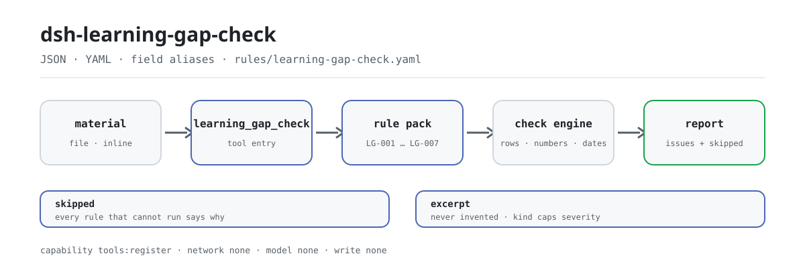

<div align="center">

<picture>
  <source media="(prefers-color-scheme: dark)" srcset="docs/assets/dsh-learning-gap-check-flow-dark.svg">
  
</picture>

# dsh-learning-gap-check

**Close the arithmetic and the loop on a competency-gap and development-plan register in one call — differences only, no verdicts.**

A DeepSeek Harness checker for training and HR teams: read a JSON/YAML register (employee header plus one row per competency), check the level arithmetic, development actions, owners and deadlines against a replaceable rule pack, and return where the row, the column and the difference are.

[Install](#three-step-setup) · [Configuration](#configuration) · [FAQ](#faq) · [简体中文](README.md) · [English](README.en.md) · [Español](README.es.md) · [Português](README.pt.md) · [हिन्दी](README.hi.md)

[](LICENSE)
[](#compatibility)
[](https://www.npmjs.com/package/dsh-learning-gap-check)
[](https://github.com/PerryLink/dsh-learning-gap-check/actions/workflows/ci.yml)
[](#compatibility)

[](https://github.com/PerryLink/dsh-learning-gap-check/stargazers)
[](https://www.npmjs.com/package/dsh-learning-gap-check)
[](https://dshfind.com/plugins/PerryLink/dsh-learning-gap-check?ref=badge)
[](https://securityscorecards.dev/viewer/?uri=github.com/PerryLink/dsh-learning-gap-check)
[](https://dsh.market/)
[](https://gitee.com/perrylink/dsh-learning-gap-check)

```sh
dsh plugin --profile <name> add dsh-learning-gap-check
```

</div>

<sub>Community plugin, not affiliated with DeepSeek. Canonical repository: <https://github.com/PerryLink/dsh-learning-gap-check> (Gitee is a mirror).</sub>

## What it is

`dsh-learning-gap-check` reads one competency-gap and development-plan register — the employee header plus one row per competency — and checks that register's own arithmetic and closure: that each gap names its position and competency, that the recorded levels parse as numbers, that the gap equals the required level minus the actual level, that a gap beyond your configured threshold carries a development action, that an action names an owner and a due date, that the completion date is not later than the deadline, and that the action status comes from your own vocabulary.

It exposes a single tool to the model, `learning_gap_check`, and keeps the seven rules as data in `rules/learning-gap-check.yaml`: replace the rule pack and you replace the rule set without touching TypeScript. It lists only literal differences between the material and the clauses the rules cite; it **does not** decide whether an employee is competent, whether an assessment was objective, whether an action worked, or replace the reviewer.

## Three-step setup

1. **Install** (pick one channel):

   ```sh
   # git channel (latest main; equivalent to git+https://github.com/PerryLink/dsh-learning-gap-check.git)
   dsh plugin --profile <name> add github:PerryLink/dsh-learning-gap-check
   # npm channel (published releases)
   dsh plugin --profile <name> add dsh-learning-gap-check
   # tarball channel: pnpm pack in this repo, then
   dsh plugin --profile <name> add ./dsh-learning-gap-check-<version>.tgz
   ```

   There is no native code: `lib/index.mjs` and `rules/` are the shipped artifacts.

2. **Minimal config** (sane defaults; disable rules or add a note as needed):

   ```yaml
   - insert:
       - id: dsh-learning-gap-check
         name: dsh-learning-gap-check
         config:
           disabledRules: []
           onlyRules: []
           skipNotes: Institutional training and development policy, 2026 edition
   ```

3. **Verify it mounts**:

   ```sh
   dsh --profile <name> --dump-config | grep 'dsh-learning-gap-check'
   ```

   The repo ships a one-command walkthrough: run `pnpm run build`, then the sample.

   ```sh
   node samples/quickstart/run.mjs
   ```

   ```text
   $ node samples/quickstart/run.mjs
   learning_gap_check: 1 issue(s) — error 0, warn 1, info 0
   skipped: 2
   ```

   The sample is `samples/quickstart/input/LG-001-unsafe.json`; the expected result is `samples/quickstart/expected/result.json`.

**Uninstall**: `dsh plugin --profile <name> remove dsh-learning-gap-check` (or remove the row from the profile patch).

<details>
<summary>Install from the DSH Desktop market or through WorkBuddy / Coze</summary>

Every PerryLink plugin is listed in the built-in DSH Desktop market: **Market → Sources → Add source → paste** `https://perrylink-dsh-catalog.perrylink.workers.dev/catalog-source.json` **→ select**. Installation still requires the market's npm identity check and your confirmation.

This check is also offered as one item of the "Teaching and Review Suite": search that name in WorkBuddy / Coze (this check is one part; availability as listed).

</details>

## Core capabilities

`dsh-learning-gap-check` completes the whole register in **one tool call** and returns the issue list plus the not-run list:

- **One read-only register** — accepts JSON or YAML with an employee header and one row per competency; the material file is read only, the original is never modified, and the tool writes no file.
- **Column aliases resolved** — position, competency, required level, actual level, gap level, assessment method, assessment date, development action, owner, due date, completion date, status and reviewer all have Chinese and English aliases; matching ignores case, spaces, underscores and hyphens.
- **Seven rules, data-driven** — the rule pack is YAML and declares each check type, parameters, basis and severity; point `rulesFile` elsewhere to switch rule-set versions.
- **Arithmetic and closure** — gap formula recomputation, threshold triggers, owner and deadline, date order and status vocabulary, each reported with its row and field.
- **Skips are never silent** — a missing column, missing parameter, disabled rule or empty vocabulary goes into `skipped` with its reason; an empty issue list is not a pass.
- **No verdicts** — the rendered report passes a wording guard that forbids adjudicating terms ("compliant", "non-compliant", "rejected"), and a disclaimer is always appended.

### Rules

| Rule | What it checks | Severity | Basis kind |
|---|---|---|---|
| `LG-001` | the position and competency are recorded (at least one) | warn | derived-from-principle |
| `LG-002` | the actual level (`actualLevel`) parses as a number | warn | derived-from-principle |
| `LG-003` | the gap level equals required minus actual (tolerance `0`) | warn | derived-from-principle |
| `LG-004` | a gap beyond the threshold carries an action (unconfigured out of the box) | info | institutional-configuration |
| `LG-005` | an action names an owner and a due date | warn | derived-from-principle |
| `LG-006` | the deadline is not earlier than the completion date | warn | derived-from-principle |
| `LG-007` | the status comes from your vocabulary (unconfigured out of the box) | info | institutional-configuration |

`derived-from-principle` caps severity at `warn` and `institutional-configuration` caps it at `info`; the cap is enforced at load time, not by documentation.

### Examples

Below is one real issue excerpted from `reportJson`, produced from the `LG-001` test fixture:

**Tool** `learning_gap_check`

**Input**

~~~json
{"employee":"张工","department":"设备部","rows":[{"岗位":"","能力项":"","要求等级":"4","现有等级":"2","差距等级":"2"}]}
~~~

**Output**

~~~json
{
  "id": "dsh-learning-gap-check.LG-001.de09b5a6",
  "ruleId": "LG-001",
  "severity": "warn",
  "locator": {
    "row": 1,
    "field": "position"
  },
  "found": "第 1 行 position、competency 都为空",
  "expected": "position、competency 至少应填写一项"
}
~~~

*Observed from `tests/fixtures/LG-001/LG-001-unsafe.json`*

| You ask | What it answers |
|---|---|
| A row carries the competency but leaves the position blank. | `LG-001` reports a row only when `position` and `competency` are both empty; one of the two filled is enough. It checks that the row names a post and a competency, not whether the competency requirement for that post is reasonable or complete. |
| Our levels are written as words (`proficient`, `mastered`) or as letters (`A`/`B`/`C`) — what happens? | `LG-002` reads `actualLevel` and requires it to parse as a number, so a level written as a word or a letter is reported as unparseable. The plugin ships no competency scale: convert the register to a numeric scale, or disable `LG-002` together with `LG-003`. Parseability is all it checks — whether the assessment was objective or accurate is not judged. |
| The gap column says `3`, but required `4` minus actual `2` is `2` — does that get caught? | `LG-003` recomputes `requiredLevel − actualLevel` with a tolerance of `0` and reports the row whose stored `gapLevel` disagrees. It runs row by row only when all three columns are filled; a missing column or an all-blank field sends the rule to `skipped`, while a filled-but-non-numeric cell is reported as unparseable in its own right. A negative gap is reported as it stands, because the columns may have been transposed, and the rule does not decide how large a gap counts as a problem. |
| A row records a development action but no owner and no due date. | `LG-005` requires `owner` and `dueAt` on every row whose `action` is filled, and reports the row missing either one. It checks that the two fields are recorded; it does not judge whether the action is effective or the deadline reasonable. |
| A row's completion date is later than its due date, or the two columns were filled in the wrong order. | `LG-006` compares `dueAt` with `completedAt` on every row and reports the row when the due date falls before the completion date. The pack states its limit in its own words: it compares only the order of the two dates and does not decide whether the work was really completed on schedule. A date it cannot parse is reported in its own right instead of being passed over. |
| `LG-004` and `LG-007` never report anything — does that mean my register passed them? | No: both rules report themselves in `skipped`. `LG-004` ships with `threshold: 0`, which means unconfigured — set the gap size at which a development action becomes mandatory. `LG-007` ships with an empty status vocabulary — fill it from your institution's own wording. Once configured, `LG-004` checks only that the action column is filled and `LG-007` only that the status value is in your vocabulary; neither judges whether the action was really carried out. |

### Material format

JSON and YAML are both accepted. Here is a complete register:

```yaml
employee: 张工
department: 设备部
plan: 2026 annual competency plan
cycle: 2026 H1
rows:
  - { 序号: '1', 岗位: 设备工程师, 能力项: 设备故障诊断, 要求等级: '4',
      现有等级: '2', 差距等级: '2', 评估方法: 实操考核 + 主管评价,
      评估日期: 2026-03-01, 培养措施: 安排为期三个月的现场带教与故障复盘,
      责任人: 李主管, 完成期限: 2026-06-30, 完成日期: 2026-06-20,
      状态: 进行中, 评估人: 王经理 }
```

- The row list may be named `rows`, `items` or `gaps`; the header may carry `employee`, `department`, `plan`, `cycle` and `checkedAt`.
- Fields are optional at the reader and validated by the check engine, so a partial export produces "missing field" findings rather than a crash.
- Aliases are mapped to canonical field names after reading, so a finding locates the cell by `position`, `competency` or `gapLevel`; the row number comes from the register's sequence column when it has one (otherwise the row index).
- Convert Excel to JSON/YAML first; a chat can do that for you where the platform supports it. One call checks one register; multi-sheet merging is out of scope.

### Standards it follows

| Document | Number | Cited by rules |
|---|---|---|
| Quality management — Guidelines for competence management and people development | GB/T 19025—2023 (issued and effective 2023-03-17; under the National Technical Committee on Quality Management and Quality Assurance; clause number not obtained this pass) | LG-001, LG-002, LG-003, LG-005, LG-006 |
| Institutional training-and-development policy (institution configuration) | No unified standard (this rule rests on the institution's configured gap threshold) | LG-004 |
| Institutional training-and-development policy (institution configuration) | No unified standard (this rule rests on the institution's configured status vocabulary) | LG-007 |

The regime lives in GB/T 19025—2023 and ISO 10015:2019 (same title, current since 2019-12-17). This pass found no adoption-status field on the national standards page, so the pack **claims no adoption relationship** between the two. The 2001 edition covered a training-management system while the 2023 edition covers competence management and people development — they are not revisions of the same subject; check the current standard's cover and foreword before citing.

### Rule sources

Rule data is separate from code: every rule carries `document` / `number` / `clause` / `excerpt` / `kind` / `source`, and `excerpt` must be a verbatim quotation of at least eight characters. The loader enforces that citation discipline and caps severity by basis kind; a pack that inflates its basis fails at load instead of producing a confident-looking report.

Citation tracing is machine-enforced by `scripts/check-citations.mjs`: it looks each excerpt up in the verification record, and `rules/citations-baseline.json` records the segments not yet traceable (empty today) — the baseline can only shrink. This pass could not obtain verbatim clause text, so the pack says so in the `excerpt` field itself and keeps every rule at `warn` or `info`.

## Configuration

Every tunable is a Schemastery field in `src/config.ts`, changeable from `cordis.yml` without code edits; per-rule thresholds live in the rule pack under `rules/`.

| Key | Type | Default | Description |
|---|---|---|---|
| `rulesFile` | string | `rules/learning-gap-check.yaml` | Rule-pack path, relative to the package root; replacing the file switches the rule-set version |
| `disabledRules` | string[] | `[]` | Rule ids to stop running; each appears in `skipped` |
| `onlyRules` | string[] | `[]` | Run only these rule ids; empty runs every rule |
| `skipNotes` | string | `""` | Note appended to every `skipped` reason, e.g. naming your institution's implementing rules |
| `timeoutMs` | number | `120000` | Cooperative tool timeout budget in milliseconds |

Rule-level parameters live in the pack; the four worth knowing:

- `LG-003` `resultField` / `expression` / `tolerance` — the gap arithmetic, `requiredLevel − actualLevel` by default with no tolerance. A negative result is reported as-is, since it may mean the columns were transposed.
- `LG-004` `triggerField` / `threshold` / `requiredField` — your rule for when an action becomes mandatory. A threshold of `0` means the rule does not run; `1` means a gap of one step or more. The comparison is "at or above", so a value exactly at the threshold triggers.
- `LG-005` `conditionField` / `requiredFields` — what triggers the owner-and-deadline requirement.
- `LG-007` `values` — your status vocabulary, e.g. `[not started, in progress, completed, accepted]`. Empty means no check.

Example override in your profile patch:

```yaml
- insert:
    - id: dsh-learning-gap-check
      name: dsh-learning-gap-check
      config:
        onlyRules: [LG-001, LG-002, LG-003, LG-005, LG-006]
        skipNotes: Per our 2026 training and development policy
```

## FAQ

<details>
<summary>Is the material uploaded or written to disk?</summary>

No. The plugin makes no network request, calls no model and stores no credentials; it reads the local file passed as `file` or the inline `material` text and checks it in-process, writing no file. The report names the material source (an absolute file path or "(inline material)"), and some checks quote the offending cell (an unparseable level, a status value, a date), so that path and those values do enter the session record with the result; the whole register is never copied into the report.

</details>

<details>
<summary>Why is everything green when nothing was checked?</summary>

Read `skipped`. `LG-004` ships with `threshold: 0` and `LG-007` with an empty `values` list, so both stay off by default; a missing column or a rule disabled through `disabledRules` also lands there. An empty issue list means "the checks that ran found no differences", not "the checks that did not run passed".

</details>

<details>
<summary>Our levels are words such as "proficient" — can we use them as-is?</summary>

No. `LG-002` and `LG-003` assume numeric levels: words or letters are reported as unparseable. Convert the register to a comparable numeric scale, or disable `LG-002` and `LG-003`. The plugin ships no scale because mapping "proficient" to a number is a modelling decision the user has to make.

</details>

<details>
<summary>Does it fight other plugins over tool names, services or routes?</summary>

No. It registers one namespaced tool, `learning_gap_check`, provides no service key, registers no client slot and no `webServer` prefix, and mutates no globals; the bundle patch only `insert`s its own row. The point-by-point argument is in "Interoperability with other DSH plugins".

</details>

<details>
<summary>How big is the performance overhead?</summary>

One call reads the material into memory and each rule makes constant-time checks per row, with no network and no model call; the rule count is fixed at seven, so cost grows linearly with rows. `timeoutMs` is a cooperative budget: the tool checks the abort signal before and after read/parse, and the host interrupts on timeout.

</details>

## Security boundaries

- **Read-only material.** The tool reads the file behind `file` (UTF-8) or uses inline `material`; it writes no file and modifies no original. The demo declaration in `package.json` says `writes: []` and `network: false`, and the only capability is `tools:register`.
- **No network, no model call, no credentials.** Checking is pure in-process computation; there is no path that sends the material off the machine.
- **No verdicts.** The rendered report passes the wording guard in `src/shared/wording.ts`, which forbids adjudicating terms ("compliant", "non-compliant", "rejected", "passed acceptance"), and a disclaimer is always appended; a finding describes the row, the column and what was expected.
- **Citations are never invented.** An excerpt must be a verbatim quotation of at least eight characters; when the basis is only a principle (`derived-from-principle`) or institutional configuration (`institutional-configuration`), severity is capped at `warn` and `info` respectively. When the text was not obtained, the `excerpt` field says so.
- **Skips are never silent.** Every check that cannot run goes into `skipped` with a reason; an empty issue list is never rendered as "no problem".
- **Fails at load.** The rule pack is validated on load: unknown check kinds, incomplete parameters and invalid regexes fail loudly rather than running with broken rules.
- **Registration is an effect.** `ctx.tools.register` returns a disposer, so the tool is removed when the plugin unloads or hot-reloads.
- **Cooperative timeout.** The abort signal is checked at read and parse boundaries; a timeout leaves no background work.

## Known limitations

**Boundary:** this plugin checks a **competency-gap and development-plan register** for arithmetic and closure — that each gap names its position and competency, that the two level columns parse as numbers, that the gap equals required minus actual, that a gap beyond your threshold carries a development action, that an action names an owner and a due date, that the completion date is not later than the deadline, and that the action status comes from your vocabulary. It does **not** decide whether an employee is competent, whether an assessment was objective, whether a development action worked, or whether someone should be reassigned or dismissed.

> ### ⚠️ What this plugin deliberately leaves out
>
> **It ships no competency scale, and it assumes the levels are numbers.** `LG-002` and `LG-003` read numeric columns and check the arithmetic between them. A register using letter grades (`A`/`B`/`C`) or words (`proficient`/`mastered`) is **reported as unparseable**, because comparing such levels is a modelling decision the plugin will not make for you. Convert the scale, or disable those rules.
>
> **It ships no threshold for "big enough to need action".** How much of a gap obliges a development action is the institution's talent-management call — some units require one for any shortfall, others tolerate a step — so `LG-004`'s threshold starts at `0` and the rule reports itself in `skipped` until you set it.
>
> **The status vocabulary ships empty** for the same reason. And the date rule checks only that the deadline does not precede the completion date, which is a data-entry property: **it does not judge whether the work was done late.**
>
> **Every `excerpt` in the rule pack says, in so many words, that the clause text was not obtained.** The regime lives in GB/T 19025 and each institution's qualification and training rules. The verification pass could not retrieve verbatim clause text, so the pack states the gap in the `excerpt` field itself and keeps every rule at `warn` or `info`. **When the texts are in hand, replace each `excerpt` with the real clause and raise `kind` to `direct`.**

Other limits:

- **Dates are compared for order only.** `LG-006` compares the date parts of `dueAt` and `completedAt`, does no time-zone conversion and does not judge lateness; a completion date earlier than the deadline is also reported, because it usually means the columns were transposed. Supported date forms are `2026-03-15` and `2026-03-15 09:30`.
- **Alias matching is literal.** It normalises case, spaces, underscores and hyphens only; it does not infer synonyms or fuzzy-match. A new column name outside the alias table in `src/model.ts` is treated as a missing column until you add it.
- **One register per call.** The tool takes a single file or one inline text; multi-sheet, multi-department or multi-cycle consolidation has to be split or merged first.
- **Numbers are extracted.** Numeric checks pull a number out of the text (tolerating full-width digits, thousands separators and spaces); `level 3` parses as `3`, while `level three` does not.
- **Cooperative timeout.** `timeoutMs` relies on the host's abort signal; a very large register should be split by the caller.
- **`check` may report `manifest-peers` as failed.** The static checker compares against a hard-coded peer range that predates the 0.2 line; the runtime enforces peer compatibility at install time, so the declared range is the correct one. This is a known upstream issue in `dsh-plugin-dev`.
- **The tool does not appear after install.** Check that `main` resolves to `lib/index.mjs` and that `pnpm run build` produced it; a wrong `main` makes the loader skip the entry silently.

## Interoperability with other DSH plugins

This plugin occupies one tool name and touches no shared event:

- **One tool name.** It registers only `learning_gap_check`, namespaced; it takes no bare name owned by a built-in tool or another plugin.
- **No service key.** It provides no service key, so it cannot collide on one.
- **No slot.** It registers no client slot key, so it does not contend for a `shadows-shipped-ui` seat.
- **No HTTP route.** It registers no `webServer` prefix.
- **No event listener.** It never calls `ctx.on()`, so it does not interact with any plugin's `agent/pre-step` or `tools/*` chain and cannot short-circuit another listener.
- **No patch-layer collision.** The bundle patch only `insert`s its own row; it never overrides a built-in row's `config`.
- **No global mutation.** It does not patch prototypes, rewrite `process.env`, or replace the global fetch dispatcher.
- **Explicit dependency.** `inject: ['tools']`: without the tools service the plugin does not load (fail closed) instead of half-starting and silently losing its function.

Static evidence: `src/index.ts:76-140` only calls `ctx.tools.register` and returns the disposer as an effect; `cordis.patch.yml:6-8` contains a single `insert`; `package.json#dsh.capabilities` contains only `tools:register`.

## Compatibility

| Surface | Status |
|---|---|
| Harness | Peer range `>=0.1.2-rc.1 <0.2.0 \|\| >=0.2.0-0 <0.3.0` — verified to accept both `0.2.0-rc.2` and `0.2.1-rc.2`. `engines.dsh` is declared as `>=0.2.1-0 <0.3.0` and is enforced by the host since 0.2.1 |
| Node | `^22.19.0 \|\| >=24.0.0` |
| Platforms | All (plain ESM; no native code, no network, no model call) |
| Tool mode | Works in `native` and `ptc`; for repeated calls in one session `ptc` pays the schema cost once |

## Ecosystem & quality

- [Gitee mirror](https://gitee.com/perrylink/dsh-learning-gap-check) (sync mirror; GitHub is canonical)
- [dshfind plugin page](https://dshfind.com/plugins/PerryLink/dsh-learning-gap-check) (installs and ranking)
- [OpenSSF Scorecard report](https://securityscorecards.dev/viewer/?uri=github.com/PerryLink/dsh-learning-gap-check) (driven by [.github/workflows/scorecard.yml](.github/workflows/scorecard.yml))
- [DSH Market](https://dsh.market/) (listed)
- [Choose a checker by material](https://perrylink.github.io/zh/checkers/choose/): this repository is one of the PerryLink checker family
- [Ecosystem knowledge base](https://perrylink.github.io/dsh-plugin-guide/): plugin development guide · measured selection data · maintenance criteria

## Development

```sh
pnpm install
pnpm run typecheck            # tsc --noEmit
pnpm test                     # vitest: shared table-plugin suite plus paired fixtures per rule
pnpm run build                # tsdown -> lib/index.mjs + lib/index.d.mts
pnpm run verify:self-contained
pnpm run check:lockfile
pnpm run check:readmes        # five-language README consistency
pnpm run check:citations      # excerpt traceability
pnpm pack
node ../scripts/sync-shared.mjs dsh-learning-gap-check   # refresh src/shared
```

Directory layout:

```text
src/index.ts        tool registration, rule-pack resolution, material reading
src/config.ts       Schemastery config schema
src/model.ts        register columns, aliases and required fields
src/check.ts        pure check core (no I/O, no clock, no model access)
src/parse.ts        JSON/YAML reader
src/view.ts         model-facing result projection
src/shared/         shared table engine (copied in, not an external dependency)
rules/              the rule pack (7 rules) and the citation baseline
tests/              vitest: shared suite plus paired fixtures per rule
samples/quickstart/ one-command walkthrough
scripts/            gates and the README asset generator
```

The plugin is **data-driven**: `src/model.ts` declares the table shape, the shared kit supplies the reader and the check engine, and the rule pack declares every check. The README images are generated by [`scripts/gen-readme-assets.py`](scripts/gen-readme-assets.py) (Pillow skeleton, hand-written SVG) and are safe to re-run; with no UI and no benchmark data this repo produces only the light/dark flow pair.

Topics: `deepseek-harness`, `dsh`, `dsh-plugin`, `cordis`, `learning`, `gap`

## Family & thanks

This project is part of the DeepSeek Harness plugin family from [PerryLink](https://github.com/PerryLink) (all Apache-2.0). If it is useful, **a star helps the next person find it** — nothing is gated behind it.

- [@PerryLink](https://github.com/PerryLink) — creator and maintainer: the table-check engine, the `LG-*` rule pack and the five-language docs.

<details>
<summary>Expand all plugins</summary>

| Plugin | Status |
|---|---|
| **[dsh-aqua-input-check](https://github.com/PerryLink/dsh-aqua-input-check)** |  |
| **[dsh-archive-check](https://github.com/PerryLink/dsh-archive-check)** |  |
| **[dsh-auto-review](https://github.com/PerryLink/dsh-auto-review)** |  |
| **[dsh-autotier](https://github.com/PerryLink/dsh-autotier)** | 🧊 FROZEN — see the repo README |
| **[dsh-bid-ca-precheck](https://github.com/PerryLink/dsh-bid-ca-precheck)** |  |
| **[dsh-bid-qual-check](https://github.com/PerryLink/dsh-bid-qual-check)** |  |
| **[dsh-cert-mcp](https://github.com/PerryLink/dsh-cert-mcp)** | 🧊 FROZEN — see the repo README |
| **[dsh-checkpoint-rewind](https://github.com/PerryLink/dsh-checkpoint-rewind)** |  |
| **[dsh-click](https://github.com/PerryLink/dsh-click)** |  |
| **[dsh-composer-history](https://github.com/PerryLink/dsh-composer-history)** |  |
| **[dsh-contract-stance](https://github.com/PerryLink/dsh-contract-stance)** |  |
| **[dsh-customs-doc-check](https://github.com/PerryLink/dsh-customs-doc-check)** |  |
| **[dsh-data-quality](https://github.com/PerryLink/dsh-data-quality)** |  |
| **[dsh-demurrage-ledger](https://github.com/PerryLink/dsh-demurrage-ledger)** |  |
| **[dsh-doublecheck](https://github.com/PerryLink/dsh-doublecheck)** |  |
| **[dsh-drill-script-check](https://github.com/PerryLink/dsh-drill-script-check)** |  |
| **[dsh-eia-guide-check](https://github.com/PerryLink/dsh-eia-guide-check)** |  |
| **[dsh-emergency-plan](https://github.com/PerryLink/dsh-emergency-plan)** |  |
| **[dsh-essay-rubric-check](https://github.com/PerryLink/dsh-essay-rubric-check)** |  |
| **[dsh-evidence-check](https://github.com/PerryLink/dsh-evidence-check)** |  |
| **[dsh-export-ctl-check](https://github.com/PerryLink/dsh-export-ctl-check)** |  |
| **[dsh-fast](https://github.com/PerryLink/dsh-fast)** |  |
| **[dsh-fmea-table-check](https://github.com/PerryLink/dsh-fmea-table-check)** |  |
| **[dsh-forecast-penalty](https://github.com/PerryLink/dsh-forecast-penalty)** |  |
| **[dsh-fund-research](https://github.com/PerryLink/dsh-fund-research)** |  |
| **[dsh-github](https://github.com/PerryLink/dsh-github)** |  |
| **[dsh-gongwen-flow-check](https://github.com/PerryLink/dsh-gongwen-flow-check)** |  |
| **[dsh-gongwen-word-check](https://github.com/PerryLink/dsh-gongwen-word-check)** |  |
| **[dsh-guard-plan-qc](https://github.com/PerryLink/dsh-guard-plan-qc)** |  |
| **[dsh-hazchem-check](https://github.com/PerryLink/dsh-hazchem-check)** |  |
| **[dsh-hazplan-check](https://github.com/PerryLink/dsh-hazplan-check)** |  |
| **[dsh-hidden-risk-map](https://github.com/PerryLink/dsh-hidden-risk-map)** |  |
| **[dsh-hs-classify](https://github.com/PerryLink/dsh-hs-classify)** |  |
| **[dsh-icd-rule-check](https://github.com/PerryLink/dsh-icd-rule-check)** |  |
| **[dsh-industry-research](https://github.com/PerryLink/dsh-industry-research)** |  |
| **[dsh-lawcite-adapter](https://github.com/PerryLink/dsh-lawcite-adapter)** |  |
| **[dsh-laya](https://github.com/PerryLink/dsh-laya)** |  |
| **[dsh-lc-doc-check](https://github.com/PerryLink/dsh-lc-doc-check)** |  |
| **[dsh-learning-gap-check](https://github.com/PerryLink/dsh-learning-gap-check)** |  |
| **[dsh-library](https://github.com/PerryLink/dsh-library)** |  |
| **[dsh-local-ai](https://github.com/PerryLink/dsh-local-ai)** |  |
| **[dsh-lsp-actions](https://github.com/PerryLink/dsh-lsp-actions)** |  |
| **[dsh-mask](https://github.com/PerryLink/dsh-mask)** |  |
| **[dsh-mcp-panel](https://github.com/PerryLink/dsh-mcp-panel)** |  |
| **[dsh-medrec-qc](https://github.com/PerryLink/dsh-medrec-qc)** |  |
| **[dsh-memento](https://github.com/PerryLink/dsh-memento)** |  |
| **[dsh-nsfc-form-check](https://github.com/PerryLink/dsh-nsfc-form-check)** |  |
| **[dsh-nurse-record-check](https://github.com/PerryLink/dsh-nurse-record-check)** |  |
| **[dsh-observe](https://github.com/PerryLink/dsh-observe)** |  |
| **[dsh-origin-rvc-check](https://github.com/PerryLink/dsh-origin-rvc-check)** |  |
| **[dsh-ota-review-check](https://github.com/PerryLink/dsh-ota-review-check)** |  |
| **[dsh-output-styles](https://github.com/PerryLink/dsh-output-styles)** |  |
| **[dsh-paper-doc-adapter](https://github.com/PerryLink/dsh-paper-doc-adapter)** |  |
| **[dsh-permission-rules](https://github.com/PerryLink/dsh-permission-rules)** |  |
| **[dsh-permit-report-check](https://github.com/PerryLink/dsh-permit-report-check)** |  |
| **[dsh-pipeline-check](https://github.com/PerryLink/dsh-pipeline-check)** |  |
| **[dsh-pleading-draft](https://github.com/PerryLink/dsh-pleading-draft)** |  |
| **[dsh-plugin-doctor](https://github.com/PerryLink/dsh-plugin-doctor)** | 🚫 RETIRED (repo archived) |
| **[dsh-plugin-guide](https://github.com/PerryLink/dsh-plugin-guide)** |  |
| **[dsh-plugin-kit](https://github.com/PerryLink/dsh-plugin-kit)** | 🚫 RETIRED (repo archived) |
| **[dsh-plugin-upgrade](https://github.com/PerryLink/dsh-plugin-upgrade)** | 🚫 RETIRED (repo archived) |
| **[dsh-policy-brief-draft](https://github.com/PerryLink/dsh-policy-brief-draft)** |  |
| **[dsh-power-loss-split](https://github.com/PerryLink/dsh-power-loss-split)** |  |
| **[dsh-power-ticket-check](https://github.com/PerryLink/dsh-power-ticket-check)** |  |
| **[dsh-ppap-check](https://github.com/PerryLink/dsh-ppap-check)** |  |
| **[dsh-protest-deadline](https://github.com/PerryLink/dsh-protest-deadline)** |  |
| **[dsh-railway-window](https://github.com/PerryLink/dsh-railway-window)** |  |
| **[dsh-repair-order-qc](https://github.com/PerryLink/dsh-repair-order-qc)** |  |
| **[dsh-research-report](https://github.com/PerryLink/dsh-research-report)** |  |
| **[dsh-review-reply-check](https://github.com/PerryLink/dsh-review-reply-check)** |  |
| **[dsh-rulefile-check](https://github.com/PerryLink/dsh-rulefile-check)** |  |
| **[dsh-safety-brief-check](https://github.com/PerryLink/dsh-safety-brief-check)** |  |
| **[dsh-score](https://github.com/PerryLink/dsh-score)** |  |
| **[dsh-session-sync](https://github.com/PerryLink/dsh-session-sync)** |  |
| **[dsh-site-log-check](https://github.com/PerryLink/dsh-site-log-check)** |  |
| **[dsh-skill-pack-security](https://github.com/PerryLink/dsh-skill-pack-security)** |  |
| **[dsh-soe-decision-check](https://github.com/PerryLink/dsh-soe-decision-check)** |  |
| **[dsh-soilwater-check](https://github.com/PerryLink/dsh-soilwater-check)** |  |
| **[dsh-sop-sync-check](https://github.com/PerryLink/dsh-sop-sync-check)** |  |
| **[dsh-spc-gbt-adapter](https://github.com/PerryLink/dsh-spc-gbt-adapter)** |  |
| **[dsh-talk](https://github.com/PerryLink/dsh-talk)** |  |
| **[dsh-tender-extract](https://github.com/PerryLink/dsh-tender-extract)** |  |
| **[dsh-tender-matrix](https://github.com/PerryLink/dsh-tender-matrix)** |  |
| **[dsh-test-drive](https://github.com/PerryLink/dsh-test-drive)** |  |
| **[dsh-ticktick](https://github.com/PerryLink/dsh-ticktick)** | 🚫 RETIRED (repo archived) |
| **[dsh-translate](https://github.com/PerryLink/dsh-translate)** |  |
| **[dsh-warranty-calc](https://github.com/PerryLink/dsh-warranty-calc)** |  |
| **[dsh-budget](https://github.com/PerryLink/dsh-budget)** | 🧊 FROZEN — see the repo README |
| **[dsh-claude-move](https://github.com/PerryLink/dsh-claude-move)** | 🧊 FROZEN — see the repo README |
| **[dsh-defend](https://github.com/PerryLink/dsh-defend)** | 🧊 FROZEN — see the repo README |
| **[dsh-draw](https://github.com/PerryLink/dsh-draw)** | 🧊 FROZEN — see the repo README |
| **[dsh-reach](https://github.com/PerryLink/dsh-reach)** | 🧊 FROZEN — see the repo README |
| **[dsh-background-agents](https://github.com/PerryLink/dsh-background-agents)** | 🚫 RETIRED (repo archived) |
| **[dsh-session-pin](https://github.com/PerryLink/dsh-session-pin)** | 🚫 RETIRED (repo archived) |
| **[dsh-team-rooms](https://github.com/PerryLink/dsh-team-rooms)** | 🚫 RETIRED (repo archived) |

</details>

## License

[LICENSE](LICENSE) (Apache License 2.0) © 2026 dsh-learning-gap-check contributors

<p align="center"><sub>Apache-2.0 · Community plugin, not affiliated with DeepSeek.</sub></p>
