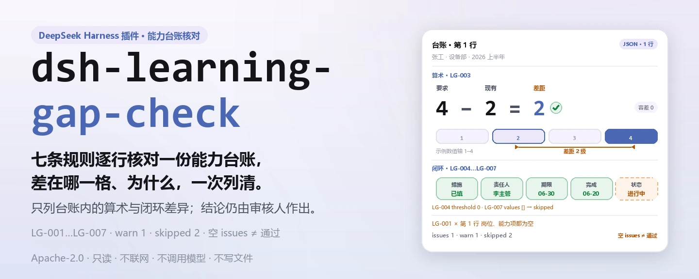
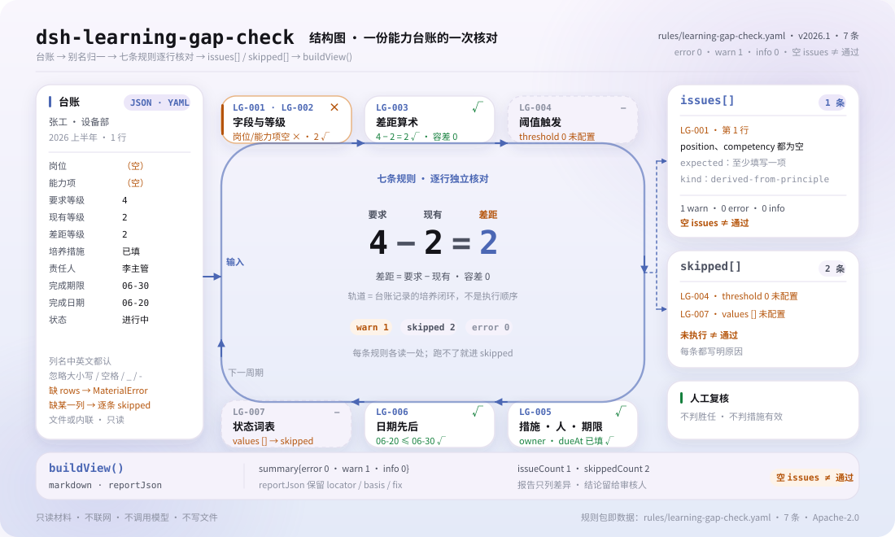

<div align="center">

<picture>
  <source media="(prefers-color-scheme: dark)" srcset="docs/assets/dsh-learning-gap-check-hero-zh-dark.webp">
  
</picture>

# dsh-learning-gap-check

**一次核完能力差距与培养计划台账的算术和闭环——只列差异，不下结论。**

面向培训与人力资源的 DeepSeek Harness 核对插件：读一份 JSON/YAML 台账（员工表头加每项能力一行），按可替换的规则包核对等级差、培养措施、责任人与期限，返回「第几行、哪一栏、差什么」。

[安装](#三步上手) · [配置](#配置) · [FAQ](#faq) · [简体中文](README.md) · [English](README.en.md) · [Español](README.es.md) · [Português](README.pt.md) · [हिन्दी](README.hi.md)

[](LICENSE)
[](#兼容性)
[](https://www.npmjs.com/package/dsh-learning-gap-check)
[](https://github.com/PerryLink/dsh-learning-gap-check/actions/workflows/ci.yml)
[](#兼容性)

[](https://github.com/PerryLink/dsh-learning-gap-check/stargazers)
[](https://www.npmjs.com/package/dsh-learning-gap-check)
[](https://dshfind.com/plugins/PerryLink/dsh-learning-gap-check?ref=badge)
[](https://securityscorecards.dev/viewer/?uri=github.com/PerryLink/dsh-learning-gap-check)
[](https://dsh.market/)
[](https://gitee.com/perrylink/dsh-learning-gap-check)

```sh
dsh plugin --profile <name> add dsh-learning-gap-check
```

</div>

<sub>社区插件，与 DeepSeek 官方无关。唯一仓库：<https://github.com/PerryLink/dsh-learning-gap-check>（Gitee 为镜像）。</sub>

## 它是什么

`dsh-learning-gap-check` 读取一份能力差距与培养计划台账——员工表头加每项能力一行——并核对这份台账自身的算术与闭环：每项差距是否写明岗位与能力项、现有等级是否可解析为数值、差距是否等于要求等级减现有等级、超过你配置阈值的差距是否填写培养措施、培养措施是否写明责任人与完成期限、完成日期是否不晚于完成期限、培养状态是否取自本机构口径。

它只向模型暴露一个工具 `learning_gap_check`，把七条规则的数据放在 `rules/learning-gap-check.yaml` 里：换掉规则库就换掉规则集，不用改 TypeScript。它只列材料与所引条款之间的字面差异，**不判定**员工是否胜任、考核是否客观、措施是否奏效，也不替代审核人。

<picture>
  <source media="(prefers-color-scheme: dark)" srcset="docs/assets/dsh-learning-gap-check-flow-v5-dark.svg">
  
</picture>

## 三步上手

1. **安装**（三选一）：

   ```sh
   # git 通道（最新 main；等价于 git+https://github.com/PerryLink/dsh-learning-gap-check.git）
   dsh plugin --profile <name> add github:PerryLink/dsh-learning-gap-check
   # npm 通道（已发布版本）
   dsh plugin --profile <name> add dsh-learning-gap-check
   # tarball 通道：本仓库 pnpm pack 后
   dsh plugin --profile <name> add ./dsh-learning-gap-check-<version>.tgz
   ```

   包内没有原生代码：`lib/index.mjs` 与 `rules/` 就是发布产物。

2. **最小配置**（默认即可用；按需停用规则或附加备注）：

   ```yaml
   - insert:
       - id: dsh-learning-gap-check
         name: dsh-learning-gap-check
         config:
           disabledRules: []
           onlyRules: []
           skipNotes: 本机构培训与发展管理口径 2026 版
   ```

3. **验证已生效**：

   ```sh
   dsh --profile <name> --dump-config | grep 'dsh-learning-gap-check'
   ```

   仓库自带一键试跑：先 `pnpm run build`，再运行样例。

   ```sh
   node samples/quickstart/run.mjs
   ```

   ```text
   $ node samples/quickstart/run.mjs
   learning_gap_check: 1 issue(s) — error 0, warn 1, info 0
   skipped: 2
   ```

   样例在 `samples/quickstart/input/LG-001-unsafe.json`，期望结果在 `samples/quickstart/expected/result.json`。

**卸载**：`dsh plugin --profile <name> remove dsh-learning-gap-check`（或从 profile patch 删掉该行）。

<details>
<summary>从 DSH Desktop 市场或 WorkBuddy / 扣子进入</summary>

所有 PerryLink 插件均可在 DSH Desktop 内置市场中浏览：**市场 → 来源 → 添加来源 → 粘贴** `https://perrylink-dsh-catalog.perrylink.workers.dev/catalog-source.json` **→ 选中**。安装仍需通过市场的 npm 身份校验与你的确认。

这项核对也作为「教学与点评核对包」的一项提供：在 WorkBuddy / 扣子搜索该名称即可（本检查是其中一项，上架以商城为准）。

</details>

## 核心能力

`dsh-learning-gap-check` 在**一次工具调用**里完成整份台账的核对，返回差异清单与未执行清单：

- **只读一份台账** —— 接受 JSON 或 YAML，员工表头加每项能力一行；材料文件只读，不修改原件，工具不写任何文件。
- **列名归一** —— 岗位、能力项、要求等级、现有等级、差距等级、评估方法、评估日期、培养措施、责任人、完成期限、完成日期、状态、评估人都有中英文别名；匹配时忽略大小写、空格、下划线连字符。
- **七条规则，数据驱动** —— 规则库是 YAML，逐条声明检查类型、参数、依据与严重级；替换 `rulesFile` 即可切换规则集版本。
- **算术与闭环** —— 差距公式重算、阈值触发、责任人与期限、日期先后、状态词表，逐项列出行号与字段。
- **未执行不静默** —— 缺列、缺参数、被停用、取值口径为空，都会逐条进入 `skipped` 并写明原因；空的差异列表不等于通过。
- **不做定性** —— 报告由措辞守卫检查，禁用「合规 / 违规 / 合格」这类判定词，并固定附上免责声明。

### 规则清单

| 规则 | 核对内容 | 严重级 | 依据类型 |
|---|---|---|---|
| `LG-001` | 岗位与能力项至少填写一项 | warn | derived-from-principle |
| `LG-002` | 现有等级（`actualLevel`）可解析为数字 | warn | derived-from-principle |
| `LG-003` | 差距等级 = 要求等级 − 现有等级（容差 `0`） | warn | derived-from-principle |
| `LG-004` | 差距达到阈值时填写培养措施（出厂未配置） | info | institutional-configuration |
| `LG-005` | 填了培养措施就写责任人与完成期限 | warn | derived-from-principle |
| `LG-006` | 完成期限不早于完成日期 | warn | derived-from-principle |
| `LG-007` | 培养状态取自本机构词表（出厂未配置） | info | institutional-configuration |

`derived-from-principle` 的严重级封顶 `warn`，`institutional-configuration` 封顶 `info`；这是加载期强制的不变量，不是文档约定。

### 示例

以下是从 `reportJson` 里截取的一条真实发现，材料为 `LG-001` 测试夹具：

**工具** `learning_gap_check`

**输入**

~~~json
{"employee":"张工","department":"设备部","rows":[{"岗位":"","能力项":"","要求等级":"4","现有等级":"2","差距等级":"2"}]}
~~~

**输出**

~~~json
{
  "id": "dsh-learning-gap-check.LG-001.de09b5a6",
  "ruleId": "LG-001",
  "severity": "warn",
  "locator": {
    "row": 1,
    "field": "position"
  },
  "found": "第 1 行 position、competency 都为空",
  "expected": "position、competency 至少应填写一项"
}
~~~

*Observed from `tests/fixtures/LG-001/LG-001-unsafe.json`*

| 你会问 | 它怎么答 |
|---|---|
| 某行填了能力项，岗位栏空着，会被报出吗？ | `LG-001` 只在 `position` 与 `competency` 都为空时报出该行，填写其中任意一项即通过。它只核对这一行有没有写明岗位与能力项，不判断该岗位的能力要求是否合理、是否完整。 |
| 台账里的等级写成「熟练」「掌握」，或者写成 A、B、C，会怎么处理？ | `LG-002` 读 `actualLevel`，要求它可解析为数值，写成文字或字母会按不可解析报出。本插件不内置任何能力等级刻度：请把台账改成可比较的数字刻度，或连同 `LG-003` 一起停用。它只核对可解析性，不判断评估结果是否客观、是否准确。 |
| 差距栏写 `3`，但要求等级 `4` 减现有等级 `2` 得 `2`，这能查出来吗？ | 能。`LG-003` 按 `requiredLevel − actualLevel` 重算，容差为 `0`，与台账里存的 `gapLevel` 不符即报出该行。只有三个字段都已填写时本条才逐行执行；缺列或全表缺项即进 `skipped`，填了但不是数字的行会单独报为无法解析。负值如实报出——可能是两栏填反了；差距大到什么程度才算问题，本条不作判断。 |
| 某行填了培养措施，但责任人和完成期限都空着。 | `LG-005` 要求凡填了 `action` 的行都必须有 `owner` 与 `dueAt`，缺任一项即报出该行。它只核对这两栏是否记录，不判断措施是否有效、期限是否合理。 |
| 某行的完成日期晚于完成期限，或者两栏填反了。 | `LG-006` 逐行比较 `dueAt` 与 `completedAt`，完成期限早于完成日期时报出该行。规则库如实写明它的限度：它只比较两个日期的先后，不判断是否真的按期完成。无法解析的日期会单独报出，不会静默放过。 |
| `LG-004` 与 `LG-007` 从来没报过东西，是不是说明这两条已经通过了？ | 不是，这两条都把自己报进 `skipped`。`LG-004` 的 `threshold` 出厂为 `0`，表示未配置——请填上「差距多大就必须提措施」；`LG-007` 的状态取值出厂为空——请按本机构口径填入。配置之后，`LG-004` 只核对培养措施栏是否填写，`LG-007` 只核对状态取值是否在册，两者都不判断措施是否真的落实。 |

### 材料格式

支持 JSON 与 YAML。下面是一份完整台账：

```yaml
employee: 张工
department: 设备部
plan: 2026 年度能力提升计划
cycle: 2026 上半年
rows:
  - { 序号: '1', 岗位: 设备工程师, 能力项: 设备故障诊断, 要求等级: '4',
      现有等级: '2', 差距等级: '2', 评估方法: 实操考核 + 主管评价,
      评估日期: 2026-03-01, 培养措施: 安排为期三个月的现场带教与故障复盘,
      责任人: 李主管, 完成期限: 2026-06-30, 完成日期: 2026-06-20,
      状态: 进行中, 评估人: 王经理 }
```

- 行列表也可命名为 `rows`、`items`、`gaps` 或 `差距`；表头可带 `employee`、`department`、`plan`、`cycle`、`checkedAt`。
- 字段在读取层是可选的，由检查引擎校验：部分导出的材料会产生「缺项」类差异，而不是让程序崩溃。
- 读取后别名统一成规范字段名，因此发现条目用 `position`、`competency`、`gapLevel` 这样的字段名定位，行号取自台账的「序号」列（缺省为行序）。
- Excel 先转成 JSON/YAML；对话里也能代转（取决于平台能力）。一次调用核对一份台账，不处理多 sheet 合并。

### 依据的标准

| 文件 | 文号 | 引用它的规则 |
|---|---|---|
| 《质量管理 能力管理和人员发展指南》 | GB/T 19025—2023（2023-03-17 发布并实施；归口全国质量管理和质量保证标准化技术委员会；条号本次未取得） | LG-001, LG-002, LG-003, LG-005, LG-006 |
| 本机构培训与发展管理口径（本机构配置） | 无统一标准（本条依据为本机构配置的差距阈值） | LG-004 |
| 本机构培训与发展管理口径（本机构配置） | 无统一标准（本条依据为本机构配置的状态口径） | LG-007 |

规范载体是 GB/T 19025—2023 与 ISO 10015:2019（同名，2019-12-17 现行）；本轮核查在国家标准页面未见「采标情况」字段，因此规则库**不声称**两者的采标关系。2001 版的主题是培训管理体系，2023 版是能力管理和人员发展，两者不是同一主题的修订——引用时请自行核对现行标准的封面与前言。

### 规则来源

规则数据与代码分离：每条规则都带 `document` / `number` / `clause` / `excerpt` / `kind` / `source`，`excerpt` 必须是逐字摘录且不少于八个字符。加载期强制这条引用纪律，并对依据类型封顶严重级；夸大依据的规则库会在加载期失败，而不会产出一份看起来很有底气的报告。

引用核验由 `scripts/check-citations.mjs` 机器执行：它把每条摘录拿去和引用核验记录比对，`rules/citations-baseline.json` 记录尚不可追溯的片段（当前为空），基线只允许缩小。本轮核验无法取得逐字条款原文，因此规则库在 `excerpt` 字段本身写明这一缺口，并把每条规则保持在 `warn` 或 `info`。

## 配置

全部可调参数都在 `src/config.ts` 的 Schemastery schema 中，只改 `cordis.yml` 即可生效，无需改代码；逐条阈值在 `rules/` 下的规则库文件里。

| 键 | 类型 | 默认值 | 说明 |
|---|---|---|---|
| `rulesFile` | string | `rules/learning-gap-check.yaml` | 规则库文件路径，相对插件包根目录；换文件即换规则集版本 |
| `disabledRules` | string[] | `[]` | 要停用的规则 id 列表；每条都会出现在 `skipped` 中 |
| `onlyRules` | string[] | `[]` | 只执行这些规则 id；留空表示执行全部规则 |
| `skipNotes` | string | `""` | 附加到每条 `skipped` 说明后的备注，例如标注本机构实施细则 |
| `timeoutMs` | number | `120000` | 工具协作式超时预算（毫秒） |

规则级参数在规则库里，常用的四个：

- `LG-003` `resultField` / `expression` / `tolerance` —— 差距算术，默认 `requiredLevel − actualLevel`、容差 `0`。负值按原样报出，因为它可能意味着两栏填反了。
- `LG-004` `triggerField` / `threshold` / `requiredField` —— 差距达到多少就必须有培养措施。`threshold: 0` 表示本条不执行；`1` 表示差距达一级及以上须有措施。比较是「达到即触发」，恰好等于阈值也算。
- `LG-005` `conditionField` / `requiredFields` —— 什么条件触发「必须写责任人与期限」。
- `LG-007` `values` —— 本机构的状态词表，例如 `[未开始, 进行中, 已完成, 已验收]`；留空表示不核对。

profile patch 覆盖示例：

```yaml
- insert:
    - id: dsh-learning-gap-check
      name: dsh-learning-gap-check
      config:
        onlyRules: [LG-001, LG-002, LG-003, LG-005, LG-006]
        skipNotes: 依据本机构 2026 版培训与发展管理口径
```

## FAQ

<details>
<summary>材料会被上传或存盘吗？</summary>

不会。插件不联网、不调用模型、不保存凭据；它只读取你通过 `file` 传入的本地文件或 `material` 内联文本，核对在当前进程内完成，不写任何文件。报告会把材料来源（文件绝对路径或「(内联材料)」）写进结果，部分检查还会引用出错单元格的原文（如无法解析的等级、状态取值、日期），因此路径与这些值会随结果进入会话记录；整份台账不会被复制进报告。

</details>

<details>
<summary>为什么全部通过却什么都没查？</summary>

先看 `skipped`。`LG-004` 的 `threshold` 出厂为 `0`、`LG-007` 的 `values` 出厂为空，这两条默认不执行；材料缺列、规则被 `disabledRules` 停用也会进 `skipped`。差异列表为空只代表「执行的检查项没发现差异」，不代表未执行的检查项通过了。

</details>

<details>
<summary>等级写的是「熟练 / 掌握」，能直接用吗？</summary>

不能直接比较。`LG-002` 与 `LG-003` 假定等级是数字：文字或字母会被报为不可解析。请把台账转换成可比较的数字刻度，或停用 `LG-002` 与 `LG-003`。插件不内置任何刻度，因为「熟练」对应几分是建模决策，应由使用方作出。

</details>

<details>
<summary>会和其他插件抢工具名、服务或路由吗？</summary>

不会。它只注册一个带命名空间的工具 `learning_gap_check`，不提供服务键、不注册客户端 slot、不注册 `webServer` 前缀、不改全局对象；bundle patch 只 `insert` 自己那一行。逐条论证见「与其他 DSH 插件的互操作性」。

</details>

<details>
<summary>性能开销多大？</summary>

一次调用把材料读入内存，规则逐条在行上做常量时间检查，无网络、无模型调用；规则数量固定为七条，开销随行数线性增长。`timeoutMs` 是协作式预算：工具在读取与解析前后检查取消信号，超时由宿主中断。

</details>

## 安全边界

- **只读材料。** 工具读 `file` 指向的文件（UTF-8）或使用内联 `material`；不写文件、不改原件。`package.json` 的 demo 声明 `writes: []`、`network: false`，能力只有 `tools:register`。
- **不联网、不调模型、不留凭据。** 核对是纯进程内计算；没有任何把材料发到远端的路径。
- **不做定性。** 渲染报告的措辞由 `src/shared/wording.ts` 守卫，禁用「合规 / 违规 / 合格 / 通过验收」这类判定词，并在报告末尾固定追加免责声明；发现条目只描述「第几行、哪一栏、期望什么」。
- **引用不伪造。** 摘录必须是逐字引文且不少于八个字符；依据只是原则性推论（`derived-from-principle`）或本机构配置（`institutional-configuration`）时，严重级分别封顶 `warn` 与 `info`。原文未取得就在 `excerpt` 字段里写明。
- **未执行不静默。** 任何无法执行的检查都进 `skipped` 并带原因；空差异列表绝不会被渲染成「没有问题」。
- **加载期失败。** 规则库在加载时校验：未知的检查类型、不完整的参数、非法正则都会响亮失败，不会带着坏规则跑出一份看似正常的报告。
- **注册即 effect。** `ctx.tools.register` 返回 disposer，插件卸载或热重载时工具随之移除。
- **协作式超时。** 取消信号在读取与解析边界检查；超时不会留下后台任务。

## 已知限制

**边界：** 本插件核对一份**能力差距与培养计划台账**的算术与闭环——每项差距是否写明其岗位与能力项，现有等级是否可解析为数字，差距是否等于要求值减实际值，超出你所设阈值的差距是否配有培养措施，措施是否写明负责人与完成期限，完成日期是否不晚于期限，以及措施状态是否取自你的取值口径。它**不**判定员工是否胜任、考核是否客观、培养措施是否奏效，也不判定某人是否应被调岗或辞退。

> ### ⚠️ 这个插件刻意不包含的内容
>
> **它不自带任何能力等级量表，并且假定等级是数字。** `LG-002` 和 `LG-003` 读取数值列，并核对它们之间的算术关系。使用字母等级（`A`/`B`/`C`）或文字（`熟练`/`掌握`）的台账会被**报为无法解析**，因为比较这种等级是一个建模决策，本插件不会替你作出。请转换等级，或者停用这些规则。
>
> **它不自带「大到需要采取行动」的阈值。** 差距达到多少才必须采取培养行动，是机构人才管理的判断——有的单位只要存在差距就要求行动，有的则容忍一个档次的差距——因此 `LG-004` 的阈值从 `0` 开始，在你设定之前，该规则会把自己记入 `skipped`。
>
> **状态词表同样因此出厂为空。** 日期规则只核对截止日期不早于完成日期，这是一项数据录入属性：**它不判断工作是否延期完成。**
>
> **规则库中的每一个 `excerpt` 都明文写着：条款原文本次未取得。** 该制度见于 GB/T 19025 与各机构自己的资格与培训规则；本轮核验无法取得逐字条款原文，因此规则库在 `excerpt` 字段本身写明这一缺口，并把每条规则保持在 `warn` 或 `info`。**待取得原文后，请把每个 `excerpt` 换成真实条款，并把 `kind` 提到 `direct`。**

其余限制：

- **日期只比先后。** `LG-006` 只比较 `dueAt` 与 `completedAt` 的日期部分，不做时区换算、不判断是否真的延期；完成日期早于期限时它同样报出，因为这通常意味着两栏填反了。日期写法支持 `2026-03-15` 与 `2026-03-15 09:30`。
- **列名匹配是字面归一。** 只做大小写、空格、下划线与连字符的归一，不做同义词推断或模糊匹配；台账用了别名表之外的新列名时，请先补充 `src/model.ts` 的别名，否则该列会被当作缺列。
- **一次一份台账。** 工具接收单个文件或一段内联文本；多 sheet、多部门或多周期的合并核对需要先拆分或汇总。
- **数值靠抽取。** 数字检查从文本中抽取数字（容忍全角数字、千分位与空格）；`3 级` 会按 `3` 解析，`三级` 则不可解析。
- **协作式超时。** `timeoutMs` 依赖宿主取消信号；极长的台账应在调用方分批处理。
- **`check` 的 `manifest-peers` 可能报失败。** 静态检查器比对的是一份早于 0.2 世代的硬编码 peer 范围；安装期的 peer 校验以运行时为准，这是 `dsh-plugin-dev` 的已知上游问题。
- **安装后工具不出现。** 确认 `main` 指向 `lib/index.mjs` 且已执行 `pnpm run build`；`main` 写错会让加载器静默跳过该条目。

## 与其他 DSH 插件的互操作性

本插件只占用一个工具名，且不接触任何共享事件：

- **工具名唯一。** 只注册 `learning_gap_check` 一个工具，带命名空间；不占用内置工具或其他插件的裸名。
- **无服务键。** 不提供任何服务键，因此不存在服务键冲突。
- **无 slot。** 不注册客户端 slot key，不参与 `shadows-shipped-ui` 座位争抢。
- **无 HTTP 路由。** 不注册任何 `webServer` 前缀。
- **无事件监听。** 不调用 `ctx.on()`，因此不与任何插件的 `agent/pre-step`、`tools/*` 链条交互，也不存在短路其它监听器的可能。
- **无 patch 层冲突。** bundle patch 只 `insert` 自己那一行，从不覆写内置行的 `config`。
- **无全局改写。** 不改原型、不改写 `process.env`、不替换全局 fetch dispatcher。
- **依赖显式。** `inject: ['tools']`：tools 服务不在时插件不加载（fail closed），不会半启动后静默丢功能。

静态证据：`src/index.ts:76-140` 只做 `ctx.tools.register` 并把 disposer 作为 effect 返回；`cordis.patch.yml:6-8` 只有一条 `insert`；`package.json#dsh.capabilities` 只有 `tools:register`。

## 兼容性

| 项目 | 状态 |
|---|---|
| Harness | 对等版本范围 `>=0.1.2-rc.1 <0.2.0 \|\| >=0.2.0-0 <0.3.0` —— 已实测同时接受 `0.2.0-rc.2` 与 `0.2.1-rc.2`。`engines.dsh` 声明为 `>=0.2.1-0 <0.3.0`，0.2.1 起由宿主单独裁决 |
| Node | `^22.19.0 \|\| >=24.0.0` |
| 平台 | 全平台（纯 ESM；无原生代码、无联网、不调用模型） |
| 工具模式 | `native` / `ptc` 均可；同一会话里多次调用建议 `ptc`，schema 成本只付一次 |

## 生态与质量

- [Gitee 镜像](https://gitee.com/perrylink/dsh-learning-gap-check)（同步镜像，以 GitHub 为准）
- [dshfind 插件页](https://dshfind.com/plugins/PerryLink/dsh-learning-gap-check)（安装量与排名）
- [OpenSSF Scorecard 报告](https://securityscorecards.dev/viewer/?uri=github.com/PerryLink/dsh-learning-gap-check)（由 [.github/workflows/scorecard.yml](.github/workflows/scorecard.yml) 驱动）
- [DSH Market](https://dsh.market/)（已上架）
- [按材料选核查器](https://perrylink.github.io/zh/checkers/choose/)：本仓只是 PerryLink 核查器家族中的一个
- [生态实测知识库](https://perrylink.github.io/dsh-plugin-guide/)：插件开发指南 · 选型实测数据 · 维护取舍判据

## 开发

```sh
pnpm install
pnpm run typecheck            # tsc --noEmit
pnpm test                     # vitest：共享表格插件套件 + 每规则成对夹具
pnpm run build                # tsdown -> lib/index.mjs + lib/index.d.mts
pnpm run verify:self-contained
pnpm run check:lockfile
pnpm run check:readmes        # 五语 README 一致性
pnpm run check:citations      # 摘录可追溯性
pnpm pack
node ../scripts/sync-shared.mjs dsh-learning-gap-check   # 刷新 src/shared
```

目录布局：

```text
src/index.ts        工具注册、规则库定位、材料读取
src/config.ts       Schemastery 配置 schema
src/model.ts        台账列、别名与要求的字段
src/check.ts        纯检查核心（无 I/O、无时钟、无模型）
src/parse.ts        JSON/YAML 读取
src/view.ts         面向模型的结果投影
src/shared/         共享表格引擎（复制进包，不外部依赖）
rules/              规则库（7 条）与引用基线
tests/              vitest：共享套件 + 每规则成对夹具
samples/quickstart/ 一键试跑样例
scripts/            校验门禁与 README 配图脚本
```

插件是**数据驱动**的：`src/model.ts` 声明表格形状，共享套件提供读取与检查引擎，规则库声明每一条检查。配图由 [`scripts/gen-readme-assets.py`](scripts/gen-readme-assets.py) 程序化生成（Python + Pillow 骨架，SVG 手写），可重复执行；本插件无 UI 与基准数据，因此只产出深浅两版流程图。

Topics：`deepseek-harness`, `dsh`, `dsh-plugin`, `cordis`, `learning`, `gap`

## 家族与致谢

本项目是 [PerryLink](https://github.com/PerryLink) 维护的 DeepSeek Harness 插件家族成员（全部 Apache-2.0）。如果这个插件帮到了你，**给个 star**——它不解锁任何功能，但会让下一个人更容易找到它。

- [@PerryLink](https://github.com/PerryLink) —— 创建者与维护者：表格核对引擎、`LG-*` 规则库与五语文档。

<details>
<summary>展开全部插件</summary>

| 插件 | 状态 |
|---|---|
| **[dsh-aqua-input-check](https://github.com/PerryLink/dsh-aqua-input-check)** |  |
| **[dsh-archive-check](https://github.com/PerryLink/dsh-archive-check)** |  |
| **[dsh-auto-review](https://github.com/PerryLink/dsh-auto-review)** |  |
| **[dsh-autotier](https://github.com/PerryLink/dsh-autotier)** | 🧊 已冻结 — 见仓库 README |
| **[dsh-bid-ca-precheck](https://github.com/PerryLink/dsh-bid-ca-precheck)** |  |
| **[dsh-bid-qual-check](https://github.com/PerryLink/dsh-bid-qual-check)** |  |
| **[dsh-cert-mcp](https://github.com/PerryLink/dsh-cert-mcp)** | 🧊 已冻结 — 见仓库 README |
| **[dsh-checkpoint-rewind](https://github.com/PerryLink/dsh-checkpoint-rewind)** |  |
| **[dsh-click](https://github.com/PerryLink/dsh-click)** |  |
| **[dsh-composer-history](https://github.com/PerryLink/dsh-composer-history)** |  |
| **[dsh-contract-stance](https://github.com/PerryLink/dsh-contract-stance)** |  |
| **[dsh-customs-doc-check](https://github.com/PerryLink/dsh-customs-doc-check)** |  |
| **[dsh-data-quality](https://github.com/PerryLink/dsh-data-quality)** |  |
| **[dsh-demurrage-ledger](https://github.com/PerryLink/dsh-demurrage-ledger)** |  |
| **[dsh-doublecheck](https://github.com/PerryLink/dsh-doublecheck)** |  |
| **[dsh-drill-script-check](https://github.com/PerryLink/dsh-drill-script-check)** |  |
| **[dsh-eia-guide-check](https://github.com/PerryLink/dsh-eia-guide-check)** |  |
| **[dsh-emergency-plan](https://github.com/PerryLink/dsh-emergency-plan)** |  |
| **[dsh-essay-rubric-check](https://github.com/PerryLink/dsh-essay-rubric-check)** |  |
| **[dsh-evidence-check](https://github.com/PerryLink/dsh-evidence-check)** |  |
| **[dsh-export-ctl-check](https://github.com/PerryLink/dsh-export-ctl-check)** |  |
| **[dsh-fast](https://github.com/PerryLink/dsh-fast)** |  |
| **[dsh-fmea-table-check](https://github.com/PerryLink/dsh-fmea-table-check)** |  |
| **[dsh-forecast-penalty](https://github.com/PerryLink/dsh-forecast-penalty)** |  |
| **[dsh-fund-research](https://github.com/PerryLink/dsh-fund-research)** |  |
| **[dsh-github](https://github.com/PerryLink/dsh-github)** |  |
| **[dsh-gongwen-flow-check](https://github.com/PerryLink/dsh-gongwen-flow-check)** |  |
| **[dsh-gongwen-word-check](https://github.com/PerryLink/dsh-gongwen-word-check)** |  |
| **[dsh-guard-plan-qc](https://github.com/PerryLink/dsh-guard-plan-qc)** |  |
| **[dsh-hazchem-check](https://github.com/PerryLink/dsh-hazchem-check)** |  |
| **[dsh-hazplan-check](https://github.com/PerryLink/dsh-hazplan-check)** |  |
| **[dsh-hidden-risk-map](https://github.com/PerryLink/dsh-hidden-risk-map)** |  |
| **[dsh-hs-classify](https://github.com/PerryLink/dsh-hs-classify)** |  |
| **[dsh-icd-rule-check](https://github.com/PerryLink/dsh-icd-rule-check)** |  |
| **[dsh-industry-research](https://github.com/PerryLink/dsh-industry-research)** |  |
| **[dsh-lawcite-adapter](https://github.com/PerryLink/dsh-lawcite-adapter)** |  |
| **[dsh-laya](https://github.com/PerryLink/dsh-laya)** |  |
| **[dsh-lc-doc-check](https://github.com/PerryLink/dsh-lc-doc-check)** |  |
| **[dsh-learning-gap-check](https://github.com/PerryLink/dsh-learning-gap-check)** |  |
| **[dsh-library](https://github.com/PerryLink/dsh-library)** |  |
| **[dsh-local-ai](https://github.com/PerryLink/dsh-local-ai)** |  |
| **[dsh-lsp-actions](https://github.com/PerryLink/dsh-lsp-actions)** |  |
| **[dsh-mask](https://github.com/PerryLink/dsh-mask)** |  |
| **[dsh-mcp-panel](https://github.com/PerryLink/dsh-mcp-panel)** |  |
| **[dsh-medrec-qc](https://github.com/PerryLink/dsh-medrec-qc)** |  |
| **[dsh-memento](https://github.com/PerryLink/dsh-memento)** |  |
| **[dsh-nsfc-form-check](https://github.com/PerryLink/dsh-nsfc-form-check)** |  |
| **[dsh-nurse-record-check](https://github.com/PerryLink/dsh-nurse-record-check)** |  |
| **[dsh-observe](https://github.com/PerryLink/dsh-observe)** |  |
| **[dsh-origin-rvc-check](https://github.com/PerryLink/dsh-origin-rvc-check)** |  |
| **[dsh-ota-review-check](https://github.com/PerryLink/dsh-ota-review-check)** |  |
| **[dsh-output-styles](https://github.com/PerryLink/dsh-output-styles)** |  |
| **[dsh-paper-doc-adapter](https://github.com/PerryLink/dsh-paper-doc-adapter)** |  |
| **[dsh-permission-rules](https://github.com/PerryLink/dsh-permission-rules)** |  |
| **[dsh-permit-report-check](https://github.com/PerryLink/dsh-permit-report-check)** |  |
| **[dsh-pipeline-check](https://github.com/PerryLink/dsh-pipeline-check)** |  |
| **[dsh-pleading-draft](https://github.com/PerryLink/dsh-pleading-draft)** |  |
| **[dsh-plugin-doctor](https://github.com/PerryLink/dsh-plugin-doctor)** | 🚫 已退役（仓库已归档） |
| **[dsh-plugin-guide](https://github.com/PerryLink/dsh-plugin-guide)** |  |
| **[dsh-plugin-kit](https://github.com/PerryLink/dsh-plugin-kit)** | 🚫 已退役（仓库已归档） |
| **[dsh-plugin-upgrade](https://github.com/PerryLink/dsh-plugin-upgrade)** | 🚫 已退役（仓库已归档） |
| **[dsh-policy-brief-draft](https://github.com/PerryLink/dsh-policy-brief-draft)** |  |
| **[dsh-power-loss-split](https://github.com/PerryLink/dsh-power-loss-split)** |  |
| **[dsh-power-ticket-check](https://github.com/PerryLink/dsh-power-ticket-check)** |  |
| **[dsh-ppap-check](https://github.com/PerryLink/dsh-ppap-check)** |  |
| **[dsh-protest-deadline](https://github.com/PerryLink/dsh-protest-deadline)** |  |
| **[dsh-railway-window](https://github.com/PerryLink/dsh-railway-window)** |  |
| **[dsh-repair-order-qc](https://github.com/PerryLink/dsh-repair-order-qc)** |  |
| **[dsh-research-report](https://github.com/PerryLink/dsh-research-report)** |  |
| **[dsh-review-reply-check](https://github.com/PerryLink/dsh-review-reply-check)** |  |
| **[dsh-rulefile-check](https://github.com/PerryLink/dsh-rulefile-check)** |  |
| **[dsh-safety-brief-check](https://github.com/PerryLink/dsh-safety-brief-check)** |  |
| **[dsh-score](https://github.com/PerryLink/dsh-score)** |  |
| **[dsh-session-sync](https://github.com/PerryLink/dsh-session-sync)** |  |
| **[dsh-site-log-check](https://github.com/PerryLink/dsh-site-log-check)** |  |
| **[dsh-skill-pack-security](https://github.com/PerryLink/dsh-skill-pack-security)** |  |
| **[dsh-soe-decision-check](https://github.com/PerryLink/dsh-soe-decision-check)** |  |
| **[dsh-soilwater-check](https://github.com/PerryLink/dsh-soilwater-check)** |  |
| **[dsh-sop-sync-check](https://github.com/PerryLink/dsh-sop-sync-check)** |  |
| **[dsh-spc-gbt-adapter](https://github.com/PerryLink/dsh-spc-gbt-adapter)** |  |
| **[dsh-talk](https://github.com/PerryLink/dsh-talk)** |  |
| **[dsh-tender-extract](https://github.com/PerryLink/dsh-tender-extract)** |  |
| **[dsh-tender-matrix](https://github.com/PerryLink/dsh-tender-matrix)** |  |
| **[dsh-test-drive](https://github.com/PerryLink/dsh-test-drive)** |  |
| **[dsh-ticktick](https://github.com/PerryLink/dsh-ticktick)** | 🚫 已退役（仓库已归档） |
| **[dsh-translate](https://github.com/PerryLink/dsh-translate)** |  |
| **[dsh-warranty-calc](https://github.com/PerryLink/dsh-warranty-calc)** |  |
| **[dsh-budget](https://github.com/PerryLink/dsh-budget)** | 🧊 已冻结 — 见仓库 README |
| **[dsh-claude-move](https://github.com/PerryLink/dsh-claude-move)** | 🧊 已冻结 — 见仓库 README |
| **[dsh-defend](https://github.com/PerryLink/dsh-defend)** | 🧊 已冻结 — 见仓库 README |
| **[dsh-draw](https://github.com/PerryLink/dsh-draw)** | 🧊 已冻结 — 见仓库 README |
| **[dsh-reach](https://github.com/PerryLink/dsh-reach)** | 🧊 已冻结 — 见仓库 README |
| **[dsh-background-agents](https://github.com/PerryLink/dsh-background-agents)** | 🚫 已退役（仓库已归档） |
| **[dsh-session-pin](https://github.com/PerryLink/dsh-session-pin)** | 🚫 已退役（仓库已归档） |
| **[dsh-team-rooms](https://github.com/PerryLink/dsh-team-rooms)** | 🚫 已退役（仓库已归档） |

</details>

## License

[LICENSE](LICENSE)（Apache License 2.0）© 2026 dsh-learning-gap-check contributors

<p align="center"><sub>Apache-2.0 · 社区插件，与 DeepSeek 无关。</sub></p>
