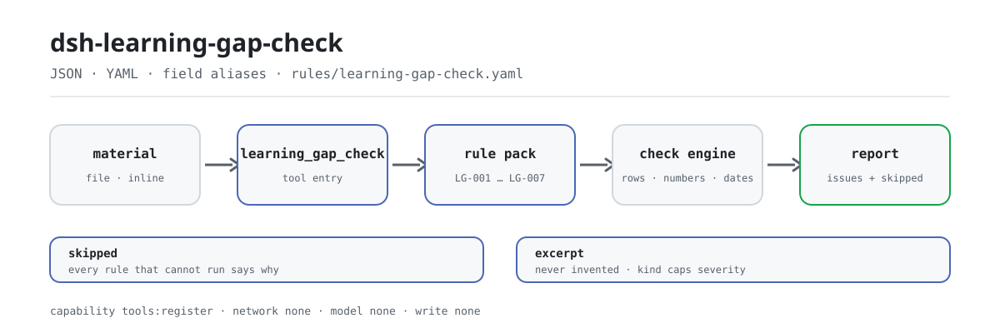

<div align="center">

<picture>
  <source media="(prefers-color-scheme: dark)" srcset="docs/assets/dsh-learning-gap-check-flow-dark.svg">
  
</picture>

# dsh-learning-gap-check

**Feche em uma única chamada a aritmética e o ciclo de um registro de lacunas de competência e plano de desenvolvimento: apenas diferenças, sem juízos.**

Um verificador do DeepSeek Harness para equipes de treinamento e recursos humanos: lê um registro JSON/YAML (cabeçalho do colaborador mais uma linha por competência), verifica a aritmética dos níveis, as ações de desenvolvimento, os responsáveis e os prazos contra um pacote de regras substituível, e devolve em qual linha, em qual coluna e qual é a diferença.

[Instalar](#instalação-em-três-passos) · [Configuração](#configuração) · [FAQ](#faq) · [简体中文](README.md) · [English](README.en.md) · [Español](README.es.md) · [Português](README.pt.md) · [हिन्दी](README.hi.md)

[](LICENSE)
[](#compatibilidade)
[](https://www.npmjs.com/package/dsh-learning-gap-check)
[](https://github.com/PerryLink/dsh-learning-gap-check/actions/workflows/ci.yml)
[](#compatibilidade)

[](https://github.com/PerryLink/dsh-learning-gap-check/stargazers)
[](https://www.npmjs.com/package/dsh-learning-gap-check)
[](https://dshfind.com/plugins/PerryLink/dsh-learning-gap-check?ref=badge)
[](https://securityscorecards.dev/viewer/?uri=github.com/PerryLink/dsh-learning-gap-check)
[](https://dsh.market/)
[](https://gitee.com/perrylink/dsh-learning-gap-check)

```sh
dsh plugin --profile <name> add dsh-learning-gap-check
```

</div>

<sub>Plugin da comunidade, sem afiliação com a DeepSeek. Repositório canônico: <https://github.com/PerryLink/dsh-learning-gap-check> (o Gitee é um espelho).</sub>

## O que é

O `dsh-learning-gap-check` lê um registro de lacunas de competência e plano de desenvolvimento —o cabeçalho do colaborador mais uma linha por competência— e verifica a aritmética e o fecho desse próprio registro: que cada lacuna indique o seu posto e a sua competência, que os níveis registados sejam analisáveis como números, que a lacuna seja igual ao nível exigido menos o nível atual, que uma lacuna acima do limiar que configurar traga uma ação de desenvolvimento, que a ação indique responsável e prazo, que a data de conclusão não seja posterior ao prazo e que o estado da ação venha do seu próprio vocabulário.

Expõe ao modelo uma única ferramenta, `learning_gap_check`, e mantém as sete regras como dados em `rules/learning-gap-check.yaml`: substituir o pacote de regras substitui o conjunto de regras sem tocar em TypeScript. Apenas lista diferenças literais entre o material e as cláusulas citadas pelas regras; **não** decide se um colaborador é competente, se uma avaliação foi objetiva, se uma ação funcionou, nem substitui o revisor.

## Instalação em três passos

1. **Instale** (escolha um canal):

   ```sh
   # canal git (último main; equivalente a git+https://github.com/PerryLink/dsh-learning-gap-check.git)
   dsh plugin --profile <name> add github:PerryLink/dsh-learning-gap-check
   # canal npm (versões publicadas)
   dsh plugin --profile <name> add dsh-learning-gap-check
   # canal tarball: pnpm pack neste repo e depois
   dsh plugin --profile <name> add ./dsh-learning-gap-check-<version>.tgz
   ```

   Não há código nativo: `lib/index.mjs` e `rules/` são os artefatos publicados.

2. **Configuração mínima** (os padrões já funcionam; desative regras ou acrescente uma nota se precisar):

   ```yaml
   - insert:
       - id: dsh-learning-gap-check
         name: dsh-learning-gap-check
         config:
           disabledRules: []
           onlyRules: []
           skipNotes: Política de treinamento e desenvolvimento 2026 da instituição
   ```

3. **Verifique que montou**:

   ```sh
   dsh --profile <name> --dump-config | grep 'dsh-learning-gap-check'
   ```

   O repositório traz um roteiro de um único comando: execute `pnpm run build` e depois a amostra.

   ```sh
   node samples/quickstart/run.mjs
   ```

   ```text
   $ node samples/quickstart/run.mjs
   learning_gap_check: 1 issue(s) — error 0, warn 1, info 0
   skipped: 2
   ```

   A amostra está em `samples/quickstart/input/LG-001-unsafe.json`; o resultado esperado, em `samples/quickstart/expected/result.json`.

**Desinstalar**: `dsh plugin --profile <name> remove dsh-learning-gap-check` (ou remova a linha do patch de perfil).

<details>
<summary>Instalar a partir do mercado do DSH Desktop ou pelo WorkBuddy / Coze</summary>

Todo plugin PerryLink está listado no mercado integrado do DSH Desktop: **Market → Sources → Add source → colar** `https://perrylink-dsh-catalog.perrylink.workers.dev/catalog-source.json` **→ selecionar**. A instalação ainda exige a verificação de identidade npm do mercado e a sua confirmação.

Esta verificação também é oferecida como um item da «Teaching and Review Suite»: procure esse nome no WorkBuddy / Coze (esta verificação é uma parte; disponibilidade conforme o catálogo).

</details>

## Capacidades principais

O `dsh-learning-gap-check` conclui todo o registro em **uma única chamada** e devolve a lista de achados e a de verificações não executadas:

- **Um registro somente leitura** — aceita JSON ou YAML com cabeçalho do colaborador e uma linha por competência; o arquivo de material só é lido, o original nunca é modificado e a ferramenta não escreve arquivo algum.
- **Aliases de coluna resolvidos** — posto, competência, nível exigido, nível atual, nível de lacuna, método de avaliação, data de avaliação, ação de desenvolvimento, responsável, prazo, data de conclusão, estado e avaliador têm aliases em chinês e inglês; a correspondência ignora maiúsculas, espaços, sublinhados e hífens.
- **Sete regras, orientadas a dados** — o pacote de regras é YAML e declara por regra o tipo de verificação, os parâmetros, a base e a gravidade; aponte `rulesFile` para outro arquivo para trocar a versão do conjunto de regras.
- **Aritmética e fecho** — recálculo da fórmula da lacuna, disparo por limiar, responsável e prazo, ordem de datas e vocabulário de estados, cada um com a sua linha e o seu campo.
- **Omissões nunca silenciosas** — coluna ausente, parâmetro ausente, regra desativada ou vocabulário vazio vão para `skipped` com o motivo; uma lista de achados vazia não é aprovação.
- **Sem juízos** — o relatório renderizado passa por um guardião de redação que proíbe termos de julgamento («conforme», «não conforme», «rejeitado») e sempre acrescenta um aviso legal.

### Regras

| Regra | O que verifica | Gravidade | Tipo de base |
|---|---|---|---|
| `LG-001` | o posto e a competência estão registados (pelo menos um) | warn | derived-from-principle |
| `LG-002` | o nível atual (`actualLevel`) é analisável como número | warn | derived-from-principle |
| `LG-003` | o nível de lacuna é igual a exigido menos atual (tolerância `0`) | warn | derived-from-principle |
| `LG-004` | uma lacuna acima do limiar traz uma ação (não configurado de fábrica) | info | institutional-configuration |
| `LG-005` | uma ação indica responsável e prazo | warn | derived-from-principle |
| `LG-006` | o prazo não é anterior à data de conclusão | warn | derived-from-principle |
| `LG-007` | o estado vem do seu vocabulário (não configurado de fábrica) | info | institutional-configuration |

`derived-from-principle` limita a gravidade a `warn` e `institutional-configuration` a `info`; o limite é imposto no carregamento, não por documentação.

### Exemplos

Abaixo está um achado real extraído de `reportJson`, produzido com o fixture de teste `LG-001`:

**Ferramenta** `learning_gap_check`

**Entrada**

~~~json
{"employee":"张工","department":"设备部","rows":[{"岗位":"","能力项":"","要求等级":"4","现有等级":"2","差距等级":"2"}]}
~~~

**Saída**

~~~json
{
  "id": "dsh-learning-gap-check.LG-001.de09b5a6",
  "ruleId": "LG-001",
  "severity": "warn",
  "locator": {
    "row": 1,
    "field": "position"
  },
  "found": "第 1 行 position、competency 都为空",
  "expected": "position、competency 至少应填写一项"
}
~~~

*Observed from `tests/fixtures/LG-001/LG-001-unsafe.json`*

| Você pergunta | O que ele responde |
|---|---|
| Uma linha traz a competência mas deixa o posto em branco. | `LG-001` só assinala uma linha quando `position` e `competency` estão ambas vazias; basta que uma delas esteja preenchida. Verifica que a linha indique o posto e a competência, não se a exigência de competência desse posto é razoável ou completa. |
| Os nossos níveis estão escritos com palavras (`proficient`, `mastered`) ou com letras (A/B/C) — o que acontece? | `LG-002` lê `actualLevel` e exige que seja analisável como número, pelo que um nível em palavras ou letras é reportado como não analisável. O plugin não inclui qualquer escala de competência: converta o registo para uma escala numérica ou desative `LG-002` juntamente com `LG-003`. A analisabilidade é tudo o que verifica; não julga se a avaliação foi objetiva ou exata. |
| A coluna da lacuna diz `3`, mas `4` menos `2` dá `2` — isso é detetado? | Sim. `LG-003` recalcula `requiredLevel − actualLevel` com tolerância `0` e assinala a linha cujo `gapLevel` registado não coincide. Só corre linha a linha quando as três colunas estão preenchidas; uma coluna ausente ou um campo vazio em toda a tabela envia a regra para `skipped`, enquanto uma célula preenchida mas não numérica é reportada como não analisável por direito próprio. Um valor negativo é reportado tal como está, porque as colunas podem estar trocadas, e a regra não decide a partir de que dimensão a lacuna é um problema. |
| Uma linha regista uma ação de desenvolvimento, mas sem responsável nem prazo. | `LG-005` exige `owner` e `dueAt` em todas as linhas com `action` preenchida e assinala a linha à qual falta um dos dois. Verifica que os dois campos estejam registados; não julga se a ação é eficaz nem se o prazo é razoável. |
| A data de conclusão de uma linha é posterior ao seu prazo, ou as duas colunas estão trocadas. | `LG-006` compara `dueAt` com `completedAt` em cada linha e assinala a linha quando o prazo é anterior à data de conclusão. O pacote de regras declara o seu limite por palavras próprias: compara apenas a ordem das duas datas e não decide se o trabalho foi realmente concluído dentro do prazo. Uma data que não consegue analisar é reportada à parte em vez de ser ignorada. |
| `LG-004` e `LG-007` nunca reportam nada — significa que o meu registo passou nestas regras? | Não: ambas as regras se declaram em `skipped`. `LG-004` vem com `threshold: 0`, ou seja, por configurar: defina a partir de que lacuna a ação de desenvolvimento é obrigatória. `LG-007` vem com o vocabulário de estados vazio: preencha-o com a terminologia da sua instituição. Depois de configuradas, `LG-004` verifica apenas que a coluna da ação está preenchida e `LG-007` apenas que o valor do estado consta do seu vocabulário; nenhuma julga se a ação foi realmente executada. |

### Formato do material

JSON e YAML são aceitos. Aqui está um registro completo:

```yaml
employee: 张工
department: 设备部
plan: Plano de competências 2026
cycle: 2026 H1
rows:
  - { 序号: '1', 岗位: 设备工程师, 能力项: 设备故障诊断, 要求等级: '4',
      现有等级: '2', 差距等级: '2', 评估方法: 实操考核 + 主管评价,
      评估日期: 2026-03-01, 培养措施: 安排为期三个月的现场带教与故障复盘,
      责任人: 李主管, 完成期限: 2026-06-30, 完成日期: 2026-06-20,
      状态: 进行中, 评估人: 王经理 }
```

- A lista de linhas pode chamar-se `rows`, `items`, `gaps` ou `差距`; o cabeçalho pode trazer `employee`, `department`, `plan`, `cycle` e `checkedAt`.
- Os campos são opcionais no leitor e validados pelo motor, de modo que uma exportação parcial produz achados de «campo ausente» em vez de falha.
- Os aliases são convertidos em nomes de campo canônicos após a leitura, portanto um achado localiza a célula por `position`, `competency` ou `gapLevel`; o número da linha vem da coluna de sequência do registo quando existe (caso contrário, do índice).
- Converta o Excel em JSON/YAML primeiro; um chat pode fazer isso onde a plataforma permitir. Uma chamada verifica um registo; a fusão de várias planilhas está fora do escopo.

### Normas seguidas

| Documento | Número | Regras que o citam |
|---|---|---|
| Quality management — Guidelines for competence management and people development | GB/T 19025—2023 (publicada e em vigor desde 2023-03-17; a cargo do Comitê Técnico Nacional de Gestão da Qualidade e Garantia da Qualidade; número da cláusula não obtido nesta passagem) | LG-001, LG-002, LG-003, LG-005, LG-006 |
| Política institucional de treinamento e desenvolvimento (configuração da instituição) | Sem norma unificada (esta regra assenta no limiar de lacuna configurado pela instituição) | LG-004 |
| Política institucional de treinamento e desenvolvimento (configuração da instituição) | Sem norma unificada (esta regra assenta no vocabulário de estados configurado pela instituição) | LG-007 |

O regime vive em GB/T 19025—2023 e ISO 10015:2019 (mesmo título, vigente desde 2019-12-17). Nesta passagem não se encontrou campo de «estado de adoção» na página nacional de normas, por isso o pacote **não afirma qualquer relação de adoção** entre as duas. A edição de 2001 tratava de um sistema de gestão de treinamento e a de 2023 trata da gestão de competências e do desenvolvimento de pessoas: não são revisões do mesmo tema; confira a capa e o prólogo da norma vigente antes de citar.

### Origem das regras

Os dados das regras estão separados do código: cada regra traz `document` / `number` / `clause` / `excerpt` / `kind` / `source`, e `excerpt` deve ser uma citação literal de pelo menos oito caracteres. O carregador impõe essa disciplina de citação e limita a gravidade pelo tipo de base; um pacote que infle a sua base falha ao carregar em vez de produzir um relatório que pareça sólido.

A rastreabilidade das citações é executada à máquina por `scripts/check-citations.mjs`: procura cada trecho no registo de verificação, e `rules/citations-baseline.json` regista os segmentos ainda não rastreáveis (hoje vazio); a linha de base só pode encolher. Esta passagem não conseguiu obter o texto literal das cláusulas, por isso o pacote diz isso no próprio campo `excerpt` e mantém cada regra em `warn` ou `info`.

## Configuração

Todos os parâmetros ajustáveis são campos Schemastery de `src/config.ts`, alteráveis pelo `cordis.yml` sem tocar no código; os limites por regra ficam no pacote de regras sob `rules/`.

| Chave | Tipo | Padrão | Descrição |
|---|---|---|---|
| `rulesFile` | string | `rules/learning-gap-check.yaml` | Caminho do pacote de regras, relativo à raiz do pacote; trocar o arquivo troca a versão do conjunto de regras |
| `disabledRules` | string[] | `[]` | Ids de regras a desativar; cada uma aparece em `skipped` |
| `onlyRules` | string[] | `[]` | Executar apenas estas regras; vazio executa todas |
| `skipNotes` | string | `""` | Nota acrescentada a cada motivo de `skipped`, por exemplo o nome das normas internas da sua instituição |
| `timeoutMs` | number | `120000` | Orçamento de tempo limite cooperativo da ferramenta, em milissegundos |

Os parâmetros por regra ficam no pacote; os quatro que vale a pena conhecer:

- `LG-003` `resultField` / `expression` / `tolerance` — a aritmética da lacuna, `requiredLevel − actualLevel` por padrão e sem tolerância. Um resultado negativo é reportado tal como está, porque pode significar que as colunas estão trocadas.
- `LG-004` `triggerField` / `threshold` / `requiredField` — a sua regra para quando uma ação passa a ser obrigatória. Um limiar de `0` significa que a regra não corre; `1` significa uma lacuna de um degrau ou mais. A comparação é «igual ou acima», portanto um valor exatamente no limiar dispara.
- `LG-005` `conditionField` / `requiredFields` — o que dispara a exigência de responsável e prazo.
- `LG-007` `values` — o seu vocabulário de estados, por exemplo `[não iniciado, em curso, concluído, aceito]`. Vazio significa que não se verifica.

Exemplo de sobrescrita no seu patch de perfil:

```yaml
- insert:
    - id: dsh-learning-gap-check
      name: dsh-learning-gap-check
      config:
        onlyRules: [LG-001, LG-002, LG-003, LG-005, LG-006]
        skipNotes: Conforme a nossa política de treinamento e desenvolvimento de 2026
```

## FAQ

<details>
<summary>O material é enviado ou gravado em disco?</summary>

Não. O plugin não faz requisições de rede, não chama modelo algum e não armazena credenciais; lê o arquivo local indicado em `file` ou o texto em linha de `material` e verifica no processo, sem escrever nenhum arquivo. O relatório nomeia a origem do material (um caminho absoluto ou «(material em linha)»), e algumas verificações citam a célula infratora (um nível não analisável, um valor de estado, uma data), portanto esse caminho e esses valores entram no registo de sessão junto com o resultado; o registo completo nunca é copiado para o relatório.

</details>

<details>
<summary>Por que está tudo verde se nada foi verificado?</summary>

Leia `skipped`. `LG-004` vem com `threshold: 0` e `LG-007` com a lista `values` vazia, por isso ambas ficam desligadas por padrão; uma coluna ausente ou uma regra desativada por `disabledRules` também acaba ali. Uma lista de achados vazia significa «as verificações que correram não encontraram diferenças», não «as que não correram passaram».

</details>

<details>
<summary>Os nossos níveis são palavras como «proficiente» — podemos usá-los como estão?</summary>

Não. `LG-002` e `LG-003` pressupõem níveis numéricos: palavras ou letras são reportadas como não analisáveis. Converta o registo para uma escala numérica comparável ou desative `LG-002` e `LG-003`. O plugin não inclui escala porque mapear «proficiente» para um número é uma decisão de modelagem que cabe ao usuário.

</details>

<details>
<summary>Ele briga com outros plugins por nomes de ferramenta, serviços ou rotas?</summary>

Não. Regista uma única ferramenta com namespace, `learning_gap_check`, não fornece nenhuma chave de serviço, não registra slots de cliente nem prefixos `webServer`, e não muta globais; o patch do bundle apenas faz `insert` da própria linha. O argumento ponto a ponto está em «Interoperabilidade com outros plugins DSH».

</details>

<details>
<summary>Qual é o tamanho do custo de desempenho?</summary>

Uma chamada lê o material em memória e cada regra faz verificações de tempo constante por linha, sem rede nem chamadas de modelo; o número de regras é fixo (sete), portanto o custo cresce linearmente com as linhas. `timeoutMs` é um orçamento cooperativo: a ferramenta verifica o sinal de aborto antes e depois de ler/analisar, e o host interrompe ao esgotar.

</details>

## Limites de segurança

- **Material somente leitura.** A ferramenta lê o arquivo de `file` (UTF-8) ou usa o `material` em linha; não escreve arquivos nem modifica originais. A declaração de demonstração em `package.json` indica `writes: []` e `network: false`, e a única capacidade é `tools:register`.
- **Sem rede, sem chamadas de modelo, sem credenciais.** A verificação é cálculo puro em processo; não há caminho que envie o material para fora da máquina.
- **Sem juízos.** O relatório renderizado passa pelo guardião de redação de `src/shared/wording.ts`, que proíbe termos de julgamento («conforme», «não conforme», «rejeitado», «passou na aceitação»), e um aviso legal é sempre acrescentado; um achado descreve a linha, a coluna e o que se esperava.
- **As citações não são inventadas.** Um trecho deve ser uma citação literal de pelo menos oito caracteres; quando a base é apenas um princípio (`derived-from-principle`) ou configuração institucional (`institutional-configuration`), a gravidade é limitada a `warn` e `info`, respectivamente. Quando o texto não foi obtido, o campo `excerpt` diz isso.
- **Omissões nunca silenciosas.** Toda verificação que não possa correr vai para `skipped` com um motivo; uma lista de achados vazia nunca é apresentada como «sem problemas».
- **Falha ao carregar.** O pacote de regras é validado ao carregar: tipos de verificação desconhecidos, parâmetros incompletos e expressões regulares inválidas falham em voz alta em vez de correr com regras quebradas.
- **O registo é um efeito.** `ctx.tools.register` devolve um disposer, portanto a ferramenta é removida quando o plugin é descarregado ou recarregado a quente.
- **Tempo limite cooperativo.** O sinal de aborto é verificado nos limites de leitura e análise; um tempo esgotado não deixa trabalho em segundo plano.

## Limitações conhecidas

**Limite:** este plugin verifica um **registo de lacunas de competência e plano de desenvolvimento** na sua aritmética e no seu fecho — que cada lacuna nomeie o seu posto e a sua competência, que as duas colunas de nível sejam analisáveis como números, que a lacuna seja exigido menos atual, que uma lacuna acima do seu limiar traga uma ação de desenvolvimento, que a ação nomeie responsável e prazo, que a data de conclusão não seja posterior ao prazo e que o estado da ação venha do seu vocabulário. **Não** decide se um colaborador é competente, se uma avaliação foi objetiva, se uma ação de desenvolvimento funcionou, nem se alguém deveria ser realocado ou desligado.

> ### ⚠️ O que este plugin deixa de fora deliberadamente
>
> **Não inclui qualquer escala de competência e pressupõe que os níveis são números.** `LG-002` e `LG-003` leem colunas numéricas e verificam a aritmética entre elas. Um registo com notas por letras (`A`/`B`/`C`) ou palavras (`proficient`/`mastered`) é **reportado como não analisável**, porque comparar esses níveis é uma decisão de modelagem que o plugin não tomará por você. Converta a escala ou desative essas regras.
>
> **Não inclui um limiar para «grande o bastante para exigir ação».** Quanta lacuna obriga a uma ação de desenvolvimento é uma decisão de gestão de talentos da instituição —algumas unidades exigem-na para qualquer déficit, outras toleram um degrau—, por isso o limiar de `LG-004` começa em `0` e a regra declara-se em `skipped` até você defini-lo.
>
> **O vocabulário de estados também vem vazio** pela mesma razão. E a regra de datas só verifica que o prazo não é anterior à data de conclusão, uma propriedade de preenchimento: **não julga se o trabalho foi feito com atraso.**
>
> **Cada `excerpt` do pacote diz, com todas as letras, que o texto da cláusula não foi obtido.** O regime vive em GB/T 19025 e nas normas de qualificação e treinamento de cada instituição. A passagem de verificação não conseguiu recuperar o texto literal, por isso o pacote declara a lacuna no próprio campo `excerpt` e mantém cada regra em `warn` ou `info`. **Quando tiver os textos, substitua cada `excerpt` pela cláusula real e eleve `kind` para `direct`.**

Outras limitações:

- **As datas só são comparadas por ordem.** `LG-006` compara as partes de data de `dueAt` e `completedAt`, não converte fusos horários nem julga atrasos; uma data de conclusão anterior ao prazo também é reportada, porque costuma significar que as colunas estão trocadas. Os formatos aceitos são `2026-03-15` e `2026-03-15 09:30`.
- **A correspondência de aliases é literal.** Só normaliza maiúsculas, espaços, sublinhados e hífens; não infere sinônimos nem faz correspondência difusa. Um nome de coluna novo fora da tabela de aliases de `src/model.ts` é tratado como coluna ausente até você adicioná-lo.
- **Um registo por chamada.** A ferramenta recebe um único arquivo ou um texto em linha; a consolidação de várias planilhas, departamentos ou ciclos precisa ser dividida ou fundida antes.
- **Os números são extraídos.** As verificações numéricas extraem um número do texto (toleram dígitos de largura total, separadores de milhar e espaços); `nível 3` é analisado como `3`, enquanto `nível três` não é.
- **Tempo limite cooperativo.** `timeoutMs` depende do sinal de aborto do host; um registo muito grande deve ser dividido por quem chama.
- **`check` pode informar `manifest-peers` como falha.** O verificador estático compara com uma faixa de peers codificada que antecede a linha 0.2; o runtime aplica a compatibilidade na instalação, portanto a faixa declarada é a correta. É um problema conhecido do `dsh-plugin-dev`.
- **A ferramenta não aparece após instalar.** Confirme que `main` resolve para `lib/index.mjs` e que `pnpm run build` o gerou; um `main` errado faz o carregador ignorar a entrada em silêncio.

## Interoperabilidade com outros plugins DSH

Este plugin ocupa um nome de ferramenta e não toca em nenhum evento compartilhado:

- **Um único nome de ferramenta.** Regista apenas `learning_gap_check`, com namespace; não toma nenhum nome puro de uma ferramenta embutida ou de outro plugin.
- **Sem chave de serviço.** Não fornece nenhuma chave de serviço, portanto não pode colidir em uma.
- **Sem slot.** Não registra nenhuma chave de slot de cliente, portanto não disputa um assento `shadows-shipped-ui`.
- **Sem rota HTTP.** Não registra nenhum prefixo `webServer`.
- **Sem listener de eventos.** Nunca chama `ctx.on()`, portanto não interage com a cadeia `agent/pre-step` nem `tools/*` de nenhum plugin e não pode curto-circuitar outro listener.
- **Sem colisão na camada de patch.** O patch do bundle apenas faz `insert` da própria linha; nunca sobrescreve o `config` de uma linha embutida.
- **Sem mutação global.** Não altera protótipos, não reescreve `process.env` nem substitui o dispatcher global de fetch.
- **Dependência explícita.** `inject: ['tools']`: sem o serviço tools o plugin não carrega (fail closed) em vez de arrancar pela metade e perder a função em silêncio.

Evidência estática: `src/index.ts:76-140` apenas chama `ctx.tools.register` e devolve o disposer como efeito; `cordis.patch.yml:6-8` contém um único `insert`; `package.json#dsh.capabilities` contém apenas `tools:register`.

## Compatibilidade

| Superfície | Estado |
|---|---|
| Harness | Faixa de peers `>=0.1.2-rc.1 <0.2.0 \|\| >=0.2.0-0 <0.3.0` — verificada para aceitar tanto `0.2.0-rc.2` quanto `0.2.1-rc.2`. `engines.dsh` é declarado como `>=0.2.1-0 <0.3.0` e o host o aplica desde 0.2.1 |
| Node | `^22.19.0 \|\| >=24.0.0` |
| Plataformas | Todas (ESM puro; sem código nativo, sem rede, sem chamada de modelo) |
| Modo de ferramenta | Funciona em `native` e `ptc`; para chamadas repetidas numa sessão, o `ptc` paga o custo do esquema uma vez |

## Ecossistema e qualidade

- [Espelho Gitee](https://gitee.com/perrylink/dsh-learning-gap-check) (espelho de sincronização; o GitHub é o canônico)
- [Página do plugin no dshfind](https://dshfind.com/plugins/PerryLink/dsh-learning-gap-check) (instalações e ranking)
- [Relatório OpenSSF Scorecard](https://securityscorecards.dev/viewer/?uri=github.com/PerryLink/dsh-learning-gap-check) (alimentado por [.github/workflows/scorecard.yml](.github/workflows/scorecard.yml))
- [DSH Market](https://dsh.market/) (listado)
- [Escolher um verificador por material](https://perrylink.github.io/zh/checkers/choose/): este repositório é um da família de verificadores PerryLink
- [Base de conhecimento do ecossistema](https://perrylink.github.io/dsh-plugin-guide/): guia de desenvolvimento de plugins · dados de seleção medidos · critérios de manutenção

## Desenvolvimento

```sh
pnpm install
pnpm run typecheck            # tsc --noEmit
pnpm test                     # vitest: suíte compartilhada de plugins de tabela + fixtures pareados por regra
pnpm run build                # tsdown -> lib/index.mjs + lib/index.d.mts
pnpm run verify:self-contained
pnpm run check:lockfile
pnpm run check:readmes        # consistência dos README em cinco idiomas
pnpm run check:citations      # rastreabilidade dos trechos
pnpm pack
node ../scripts/sync-shared.mjs dsh-learning-gap-check   # atualizar src/shared
```

Estrutura de diretórios:

```text
src/index.ts        registo da ferramenta, resolução do pacote de regras, leitura do material
src/config.ts       esquema de configuração Schemastery
src/model.ts        colunas do registo, aliases e campos exigidos
src/check.ts        núcleo de verificação puro (sem I/O, sem relógio, sem modelo)
src/parse.ts        leitor JSON/YAML
src/view.ts         projeção do resultado para o modelo
src/shared/         motor de tabelas compartilhado (copiado para dentro, não dependência externa)
rules/              o pacote de regras (7 regras) e a linha de base de citações
tests/              vitest: suíte compartilhada + fixtures pareados por regra
samples/quickstart/ roteiro de um único comando
scripts/            portões de validação e gerador de imagens do README
```

O plugin é **orientado a dados**: `src/model.ts` declara a forma da tabela, o kit compartilhado fornece o leitor e o motor, e o pacote de regras declara cada verificação. As imagens do README são geradas por [`scripts/gen-readme-assets.py`](scripts/gen-readme-assets.py) (esqueleto Pillow, SVG escrito à mão) e podem ser reexecutadas sem risco; sem UI nem dados de benchmark este repo produz apenas o par de fluxo claro/escuro.

Topics: `deepseek-harness`, `dsh`, `dsh-plugin`, `cordis`, `learning`, `gap`

## Família e agradecimentos

Este projeto faz parte da família de plugins do DeepSeek Harness da [PerryLink](https://github.com/PerryLink) (todos Apache-2.0). Se for útil, **uma estrela ajuda a próxima pessoa a encontrá-lo** — nada fica bloqueado atrás dela.

- [@PerryLink](https://github.com/PerryLink) — criador e mantenedor: o motor de verificação de tabelas, o pacote de regras `LG-*` e a documentação em cinco idiomas.

<details>
<summary>Expandir todos os plugins</summary>

| Plugin | Status |
|---|---|
| **[dsh-aqua-input-check](https://github.com/PerryLink/dsh-aqua-input-check)** |  |
| **[dsh-archive-check](https://github.com/PerryLink/dsh-archive-check)** |  |
| **[dsh-auto-review](https://github.com/PerryLink/dsh-auto-review)** |  |
| **[dsh-autotier](https://github.com/PerryLink/dsh-autotier)** | 🧊 CONGELADO — ver o README do repo |
| **[dsh-bid-ca-precheck](https://github.com/PerryLink/dsh-bid-ca-precheck)** |  |
| **[dsh-bid-qual-check](https://github.com/PerryLink/dsh-bid-qual-check)** |  |
| **[dsh-cert-mcp](https://github.com/PerryLink/dsh-cert-mcp)** | 🧊 CONGELADO — ver o README do repo |
| **[dsh-checkpoint-rewind](https://github.com/PerryLink/dsh-checkpoint-rewind)** |  |
| **[dsh-click](https://github.com/PerryLink/dsh-click)** |  |
| **[dsh-composer-history](https://github.com/PerryLink/dsh-composer-history)** |  |
| **[dsh-contract-stance](https://github.com/PerryLink/dsh-contract-stance)** |  |
| **[dsh-customs-doc-check](https://github.com/PerryLink/dsh-customs-doc-check)** |  |
| **[dsh-data-quality](https://github.com/PerryLink/dsh-data-quality)** |  |
| **[dsh-demurrage-ledger](https://github.com/PerryLink/dsh-demurrage-ledger)** |  |
| **[dsh-doublecheck](https://github.com/PerryLink/dsh-doublecheck)** |  |
| **[dsh-drill-script-check](https://github.com/PerryLink/dsh-drill-script-check)** |  |
| **[dsh-eia-guide-check](https://github.com/PerryLink/dsh-eia-guide-check)** |  |
| **[dsh-emergency-plan](https://github.com/PerryLink/dsh-emergency-plan)** |  |
| **[dsh-essay-rubric-check](https://github.com/PerryLink/dsh-essay-rubric-check)** |  |
| **[dsh-evidence-check](https://github.com/PerryLink/dsh-evidence-check)** |  |
| **[dsh-export-ctl-check](https://github.com/PerryLink/dsh-export-ctl-check)** |  |
| **[dsh-fast](https://github.com/PerryLink/dsh-fast)** |  |
| **[dsh-fmea-table-check](https://github.com/PerryLink/dsh-fmea-table-check)** |  |
| **[dsh-forecast-penalty](https://github.com/PerryLink/dsh-forecast-penalty)** |  |
| **[dsh-fund-research](https://github.com/PerryLink/dsh-fund-research)** |  |
| **[dsh-github](https://github.com/PerryLink/dsh-github)** |  |
| **[dsh-gongwen-flow-check](https://github.com/PerryLink/dsh-gongwen-flow-check)** |  |
| **[dsh-gongwen-word-check](https://github.com/PerryLink/dsh-gongwen-word-check)** |  |
| **[dsh-guard-plan-qc](https://github.com/PerryLink/dsh-guard-plan-qc)** |  |
| **[dsh-hazchem-check](https://github.com/PerryLink/dsh-hazchem-check)** |  |
| **[dsh-hazplan-check](https://github.com/PerryLink/dsh-hazplan-check)** |  |
| **[dsh-hidden-risk-map](https://github.com/PerryLink/dsh-hidden-risk-map)** |  |
| **[dsh-hs-classify](https://github.com/PerryLink/dsh-hs-classify)** |  |
| **[dsh-icd-rule-check](https://github.com/PerryLink/dsh-icd-rule-check)** |  |
| **[dsh-industry-research](https://github.com/PerryLink/dsh-industry-research)** |  |
| **[dsh-lawcite-adapter](https://github.com/PerryLink/dsh-lawcite-adapter)** |  |
| **[dsh-laya](https://github.com/PerryLink/dsh-laya)** |  |
| **[dsh-lc-doc-check](https://github.com/PerryLink/dsh-lc-doc-check)** |  |
| **[dsh-learning-gap-check](https://github.com/PerryLink/dsh-learning-gap-check)** |  |
| **[dsh-library](https://github.com/PerryLink/dsh-library)** |  |
| **[dsh-local-ai](https://github.com/PerryLink/dsh-local-ai)** |  |
| **[dsh-lsp-actions](https://github.com/PerryLink/dsh-lsp-actions)** |  |
| **[dsh-mask](https://github.com/PerryLink/dsh-mask)** |  |
| **[dsh-mcp-panel](https://github.com/PerryLink/dsh-mcp-panel)** |  |
| **[dsh-medrec-qc](https://github.com/PerryLink/dsh-medrec-qc)** |  |
| **[dsh-memento](https://github.com/PerryLink/dsh-memento)** |  |
| **[dsh-nsfc-form-check](https://github.com/PerryLink/dsh-nsfc-form-check)** |  |
| **[dsh-nurse-record-check](https://github.com/PerryLink/dsh-nurse-record-check)** |  |
| **[dsh-observe](https://github.com/PerryLink/dsh-observe)** |  |
| **[dsh-origin-rvc-check](https://github.com/PerryLink/dsh-origin-rvc-check)** |  |
| **[dsh-ota-review-check](https://github.com/PerryLink/dsh-ota-review-check)** |  |
| **[dsh-output-styles](https://github.com/PerryLink/dsh-output-styles)** |  |
| **[dsh-paper-doc-adapter](https://github.com/PerryLink/dsh-paper-doc-adapter)** |  |
| **[dsh-permission-rules](https://github.com/PerryLink/dsh-permission-rules)** |  |
| **[dsh-permit-report-check](https://github.com/PerryLink/dsh-permit-report-check)** |  |
| **[dsh-pipeline-check](https://github.com/PerryLink/dsh-pipeline-check)** |  |
| **[dsh-pleading-draft](https://github.com/PerryLink/dsh-pleading-draft)** |  |
| **[dsh-plugin-doctor](https://github.com/PerryLink/dsh-plugin-doctor)** | 🚫 APOSENTADO (repo arquivado) |
| **[dsh-plugin-guide](https://github.com/PerryLink/dsh-plugin-guide)** |  |
| **[dsh-plugin-kit](https://github.com/PerryLink/dsh-plugin-kit)** | 🚫 APOSENTADO (repo arquivado) |
| **[dsh-plugin-upgrade](https://github.com/PerryLink/dsh-plugin-upgrade)** | 🚫 APOSENTADO (repo arquivado) |
| **[dsh-policy-brief-draft](https://github.com/PerryLink/dsh-policy-brief-draft)** |  |
| **[dsh-power-loss-split](https://github.com/PerryLink/dsh-power-loss-split)** |  |
| **[dsh-power-ticket-check](https://github.com/PerryLink/dsh-power-ticket-check)** |  |
| **[dsh-ppap-check](https://github.com/PerryLink/dsh-ppap-check)** |  |
| **[dsh-protest-deadline](https://github.com/PerryLink/dsh-protest-deadline)** |  |
| **[dsh-railway-window](https://github.com/PerryLink/dsh-railway-window)** |  |
| **[dsh-repair-order-qc](https://github.com/PerryLink/dsh-repair-order-qc)** |  |
| **[dsh-research-report](https://github.com/PerryLink/dsh-research-report)** |  |
| **[dsh-review-reply-check](https://github.com/PerryLink/dsh-review-reply-check)** |  |
| **[dsh-rulefile-check](https://github.com/PerryLink/dsh-rulefile-check)** |  |
| **[dsh-safety-brief-check](https://github.com/PerryLink/dsh-safety-brief-check)** |  |
| **[dsh-score](https://github.com/PerryLink/dsh-score)** |  |
| **[dsh-session-sync](https://github.com/PerryLink/dsh-session-sync)** |  |
| **[dsh-site-log-check](https://github.com/PerryLink/dsh-site-log-check)** |  |
| **[dsh-skill-pack-security](https://github.com/PerryLink/dsh-skill-pack-security)** |  |
| **[dsh-soe-decision-check](https://github.com/PerryLink/dsh-soe-decision-check)** |  |
| **[dsh-soilwater-check](https://github.com/PerryLink/dsh-soilwater-check)** |  |
| **[dsh-sop-sync-check](https://github.com/PerryLink/dsh-sop-sync-check)** |  |
| **[dsh-spc-gbt-adapter](https://github.com/PerryLink/dsh-spc-gbt-adapter)** |  |
| **[dsh-talk](https://github.com/PerryLink/dsh-talk)** |  |
| **[dsh-tender-extract](https://github.com/PerryLink/dsh-tender-extract)** |  |
| **[dsh-tender-matrix](https://github.com/PerryLink/dsh-tender-matrix)** |  |
| **[dsh-test-drive](https://github.com/PerryLink/dsh-test-drive)** |  |
| **[dsh-ticktick](https://github.com/PerryLink/dsh-ticktick)** | 🚫 APOSENTADO (repo arquivado) |
| **[dsh-translate](https://github.com/PerryLink/dsh-translate)** |  |
| **[dsh-warranty-calc](https://github.com/PerryLink/dsh-warranty-calc)** |  |
| **[dsh-budget](https://github.com/PerryLink/dsh-budget)** | 🧊 CONGELADO — ver o README do repo |
| **[dsh-claude-move](https://github.com/PerryLink/dsh-claude-move)** | 🧊 CONGELADO — ver o README do repo |
| **[dsh-defend](https://github.com/PerryLink/dsh-defend)** | 🧊 CONGELADO — ver o README do repo |
| **[dsh-draw](https://github.com/PerryLink/dsh-draw)** | 🧊 CONGELADO — ver o README do repo |
| **[dsh-reach](https://github.com/PerryLink/dsh-reach)** | 🧊 CONGELADO — ver o README do repo |
| **[dsh-background-agents](https://github.com/PerryLink/dsh-background-agents)** | 🚫 APOSENTADO (repo arquivado) |
| **[dsh-session-pin](https://github.com/PerryLink/dsh-session-pin)** | 🚫 APOSENTADO (repo arquivado) |
| **[dsh-team-rooms](https://github.com/PerryLink/dsh-team-rooms)** | 🚫 APOSENTADO (repo arquivado) |

</details>

## Licença

[LICENSE](LICENSE) (Apache License 2.0) © 2026 dsh-learning-gap-check contributors

<p align="center"><sub>Apache-2.0 · Plugin da comunidade, sem afiliação com a DeepSeek.</sub></p>
